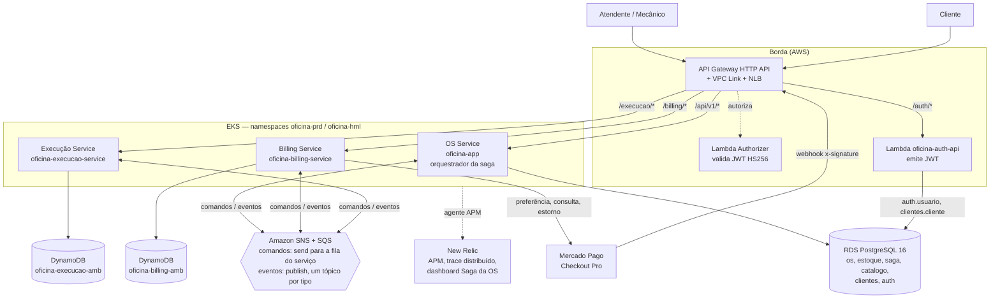
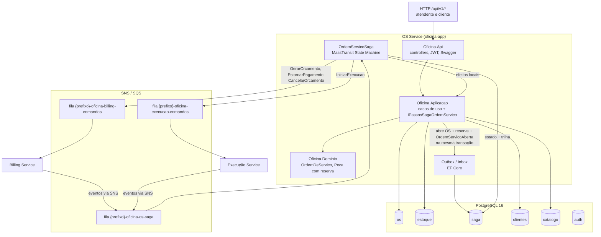
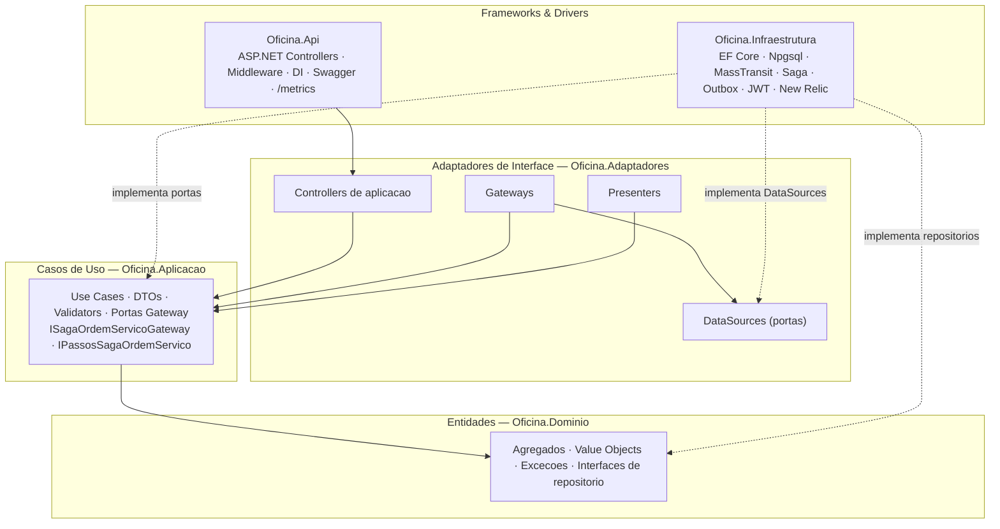
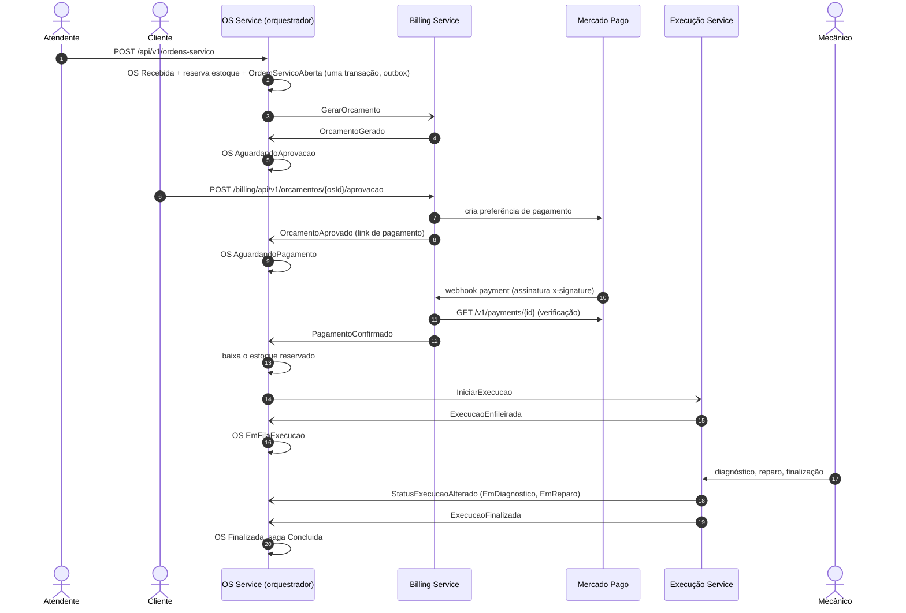
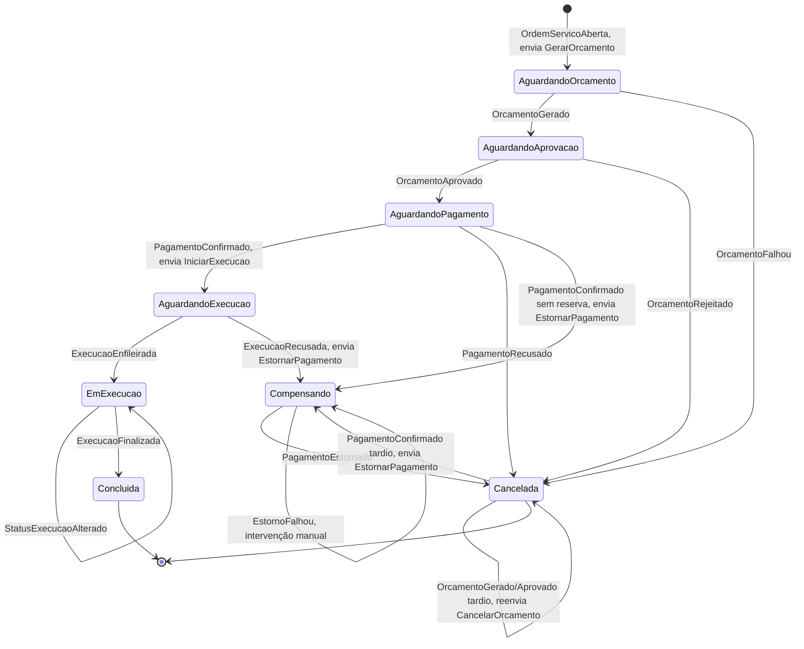
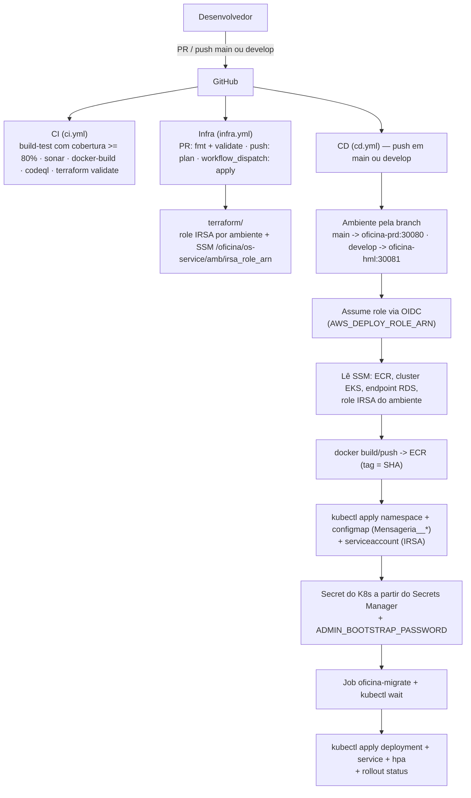

# Oficina Mecânica — **OS Service** (`oficina-app`)

> **Tech Challenge — Fase 4 — Pós-Tech FIAP (15SOAT)**

Back-end de uma oficina mecânica com várias filiais. Na Fase 4 o monólito da Fase 3 foi
dividido em **três microsserviços** independentes — cada um com repositório, banco,
infraestrutura e pipeline próprios — e o ciclo da Ordem de Serviço (OS) passou a ser
coordenado por uma **Saga orquestrada**, com compensação em cada etapa que pode falhar.

Este repositório é o **OS Service**. Ele **não foi renomeado** (continua `oficina-app`)
para manter válidos os links da entrega da Fase 3. Papel dele entre os três serviços:

- **Atendimento:** clientes, veículos, catálogo de serviços, peças/estoque, abertura e
  consulta da OS, autoatendimento do cliente (`/api/v1/me/*`).
- **Orquestrador da saga:** a `OrdemServicoSaga` (MassTransit State Machine) conduz a OS por
  orçamento, aprovação, pagamento e execução, mandando comandos ao **Billing** e à
  **Execução** e compensando quando algo falha.
- **Documentação central da Fase 4:** design, RFCs, ADRs e contratos de mensagens dos três
  serviços estão aqui ([Documentação arquitetural](#documentação-arquitetural)).

---

## Fase 4 — Arquitetura de microsserviços



Comunicação **síncrona (REST)** só na borda — atendente, cliente, mecânico e o webhook do
Mercado Pago entram pelo API Gateway. Entre os serviços, **só mensageria assíncrona**
(SNS + SQS via MassTransit): nenhum serviço chama outro por HTTP e nenhum acessa o banco do
outro. A Lambda de autenticação lê o PostgreSQL do OS Service (`auth.usuario` e
`clientes.cliente`) por contrato da Fase 3, inalterado.

### Por que três serviços e estas tecnologias

Cada escolha abaixo tem alternativas avaliadas e consequências registradas no documento
linkado; aqui fica o resumo para quem lê só este README.

| Decisão | Por quê | Alternativa descartada | Registro |
|---|---|---|---|
| **Três serviços: OS, Billing, Execução** | Mapeiam as três áreas do desafio (atendimento, cobrança, oficina) e têm ciclos e dados próprios; o Billing isola a integração externa (Mercado Pago). Clientes, veículos, catálogo e estoque ficam no OS Service: são o contexto de atendimento e a origem dos preços do orçamento | Separar também Clientes/Catálogo/Estoque (5–6 serviços para um projeto solo, sem ganho para o fluxo da OS) | [RFC-006 §2.1](docs/rfc/RFC-006-microsservicos-saga-orquestrada.md#21-divisão-em-serviços) |
| **Saga orquestrada no OS Service** (MassTransit State Machine) | 4 participantes, 3 pontos de falha e compensação em cascata: fluxo e compensações num lugar só, testável no CI com o test harness e o BDD | Coreografia (fluxo espalhado, dependência cíclica); AWS Step Functions (lógica fora do .NET, difícil de testar no CI) | [RFC-006 §2.2](docs/rfc/RFC-006-microsservicos-saga-orquestrada.md#22-coordenação-da-transação), [ADR-021](docs/arquitetura/ADR-021-saga-orquestrada-masstransit.md) |
| **Assíncrono entre serviços, REST só na borda** | Um serviço fora do ar não trava os outros: a mensagem espera na fila e a saga retoma | REST síncrono em cadeia (monolito distribuído, sem compensação) | [RFC-006 §2.2](docs/rfc/RFC-006-microsservicos-saga-orquestrada.md#22-coordenação-da-transação) |
| **Amazon SNS + SQS via MassTransit 8.x** | Gerenciado (nada para operar no EKS), custo praticamente zero, LocalStack no ambiente local; MassTransit 8.x é Apache-2.0 e traz saga, outbox, retry e test harness | RabbitMQ no cluster (StatefulSet para operar); Kafka/MSK (caro e desproporcional); MassTransit 9 (licença comercial) | [ADR-022](docs/arquitetura/ADR-022-mensageria-sns-sqs-masstransit.md) |
| **PostgreSQL 16 no OS Service** | Domínio relacional (cliente ↔ veículo ↔ OS ↔ itens ↔ peças), reserva de estoque em transação `Serializable`, estado da saga e outbox na mesma transação do domínio | — (já era o banco da Fase 3; continua no RDS do `oficina-infra-db`) | [ADR-023](docs/arquitetura/ADR-023-bancos-por-servico.md), [ADR-002](docs/arquitetura/ADR-002-postgresql.md) |
| **DynamoDB no Billing e na Execução** (o banco NoSQL exigido) | Orçamento/pagamento e fila de execução são documentos por OS lidos por chave; escrita condicional dá idempotência e lock otimista; on-demand custa centavos | MongoDB/DocumentDB (cluster e VPC; ~US$ 60/mês no menor porte) | [ADR-023](docs/arquitetura/ADR-023-bancos-por-servico.md) |
| **Outbox no OS Service, idempotência nos participantes** | Nenhuma mensagem da saga se perde nem é aplicada duas vezes; o DynamoDB não compartilha transação com o SQS, então Billing e Execução usam escrita condicional | Publicar direto após o commit (perde mensagem se o processo cair no meio) | [ADR-024](docs/arquitetura/ADR-024-outbox-e-idempotencia.md) |
| **Reserva de estoque (*semantic lock*)** | Sem o "I" de ACID na saga, outra OS não pode ler um saldo que ainda pode voltar | Baixar na abertura e devolver na compensação (leitura de saldo sujo) | [ADR-025](docs/arquitetura/ADR-025-reserva-estoque-semantic-lock.md) |
| **SonarQube no CI** (efêmero; SonarCloud com `SONAR_TOKEN`) | Análise real com quality gate em todo PR, sem depender de conta externa | Pular a análise sem token (CI verde sem análise) | [ADR-026](docs/arquitetura/ADR-026-sonarqube-efemero-no-ci.md) |

Mantidos da Fase 3: AWS (EKS, RDS, API Gateway + Lambda Authorizer), .NET 8 com Clean
Architecture, New Relic e GitHub Actions com OIDC ([RFC-001](docs/rfc/RFC-001-nuvem-aws.md) a
[RFC-005](docs/rfc/RFC-005-observabilidade-new-relic.md)).

### Repositórios da Fase 4

| Repositório | Papel | Banco | PR da Fase 4 |
|---|---|---|---|
| `oficina-app` (este) | **OS Service**: atendimento, estoque, OS e orquestrador da saga | PostgreSQL 16 (RDS) | [#41](https://github.com/lcr-thiago-fernandes/oficina-app/pull/41) |
| [`oficina-billing-service`](https://github.com/lcr-thiago-fernandes/oficina-billing-service) | Orçamento, aprovação do cliente, pagamento e estorno no Mercado Pago | DynamoDB | [#1](https://github.com/lcr-thiago-fernandes/oficina-billing-service/pull/1) |
| [`oficina-execucao-service`](https://github.com/lcr-thiago-fernandes/oficina-execucao-service) | Fila de execução por unidade, diagnóstico, reparo e finalização | DynamoDB | [#1](https://github.com/lcr-thiago-fernandes/oficina-execucao-service/pull/1) |
| [`oficina-infra-k8s`](https://github.com/lcr-thiago-fernandes/oficina-infra-k8s) | VPC, EKS, NLB, API Gateway, New Relic; na Fase 4: parâmetros SSM novos, rotas, dashboard e alertas da saga, alarmes das filas `_error` | — | [#21](https://github.com/lcr-thiago-fernandes/oficina-infra-k8s/pull/21) |
| [`oficina-infra-db`](https://github.com/lcr-thiago-fernandes/oficina-infra-db) | RDS PostgreSQL do OS Service | — | inalterado na Fase 4 |
| [`oficina-lambda-auth`](https://github.com/lcr-thiago-fernandes/oficina-lambda-auth) | Lambda de autenticação (CPF e usuário/senha) e Lambda Authorizer | — | inalterado na Fase 4 |

Portas fixadas (NodePort / listener do NLB compartilhado):

| Serviço | prd | hml | Rotas no API Gateway |
|---|---|---|---|
| OS Service | 30080 / 80 | 30081 / 81 | `ANY /api/v1/{proxy+}` (Authorizer) |
| Billing | 30082 / 8081 | 30083 / 8082 | `ANY /billing/api/v1/{proxy+}` (Authorizer), `POST /billing/webhooks/mercadopago` (sem Authorizer, assinatura do Mercado Pago) |
| Execução | 30084 / 8083 | 30085 / 8084 | `ANY /execucao/api/v1/{proxy+}` (Authorizer) |

Design completo: [docs/arquitetura/fase4-design-arquitetural.md](docs/arquitetura/fase4-design-arquitetural.md)
· decisão: [RFC-006](docs/rfc/RFC-006-microsservicos-saga-orquestrada.md).

---

## Arquitetura do OS Service



Schemas do PostgreSQL: `clientes`, `catalogo`, `estoque`, `os` e `auth` vêm da Fase 3;
`saga` é novo (`ordem_servico_saga`, `ordem_servico_saga_passo`, `inbox_state`,
`outbox_message`, `outbox_state`). Nenhuma migration da Fase 4 altera `auth` e `clientes`,
lidos pela Lambda de autenticação.

### Camadas (Clean Architecture — 5 projetos)

A regra de dependência aponta **sempre para dentro** (em direção ao Domínio). A
Infraestrutura implementa as portas declaradas nas camadas internas — inclusive as da saga.



| Projeto | Responsabilidade |
|---|---|
| `Oficina.Dominio` | Agregados (`OrdemDeServico`, `Peca` com saldo reservado), value objects, exceções. Sem dependências externas. |
| `Oficina.Aplicacao` | Casos de uso, DTOs, validators, portas Gateway e `PassosSagaOrdemServico` (efeitos locais de cada passo da saga). |
| `Oficina.Adaptadores` | Controllers de aplicação, Gateways, Presenters e DataSources. |
| `Oficina.Infraestrutura` | EF Core (`OficinaDbContext`, migrations), MassTransit (`Mensageria/`: contratos, `OrdemServicoSaga`, topologia, outbox), validação de JWT, BCrypt, New Relic. |
| `Oficina.Api` | Host ASP.NET Core: controllers finos, middleware de correlação (`X-Correlation-Id`), DI, Swagger, `/metrics`, modo Job de migração. |

Diagramas de DDD (contextos, agregados, máquina de estados da Fase 3) em [docs/entrega](docs/entrega).

### O que o serviço mantém e o que migrou

**Mantém:** clientes e veículos, catálogo de serviços, peças e movimentações de estoque,
abertura consolidada e consulta da OS, `/api/v1/me/*`, consulta do cliente
(`/api/v1/consulta/{numeroOs}`), métricas, `auth.usuario` (lida pela Lambda), histórico de
status e o evento `OrdemServicoEvento` no New Relic.

**Muda:** a abertura da OS **reserva** o estoque e inicia a saga; a OS só muda de status pela
saga, exceto `entregar` e `cancelar` (atendente). **Novo:**
`GET /api/v1/ordens-servico/{id}/saga` (estado e trilha da saga).

| Rota removida (Fase 3) | Para onde foi |
|---|---|
| `PATCH /api/v1/ordens-servico/{id}/diagnostico` | Execução: `POST /api/v1/execucoes/{osId}/diagnostico` |
| `POST /api/v1/ordens-servico/{id}/orcamento/enviar` | Saga: a abertura envia `GerarOrcamento` ao Billing |
| `POST /api/v1/ordens-servico/{id}/orcamento/aprovacao` (webhook com `X-Webhook-Token`) | Billing: `POST /api/v1/orcamentos/{osId}/aprovacao` e `/rejeicao`; webhook público só o do Mercado Pago |
| `POST /api/v1/ordens-servico/{id}/execucao/iniciar` | Saga: `IniciarExecucao` à Execução depois do pagamento confirmado |
| `POST /api/v1/ordens-servico/{id}/finalizar` | Execução: `POST /api/v1/execucoes/{osId}/reparo` e `/finalizacao` |
| `POST\|DELETE /api/v1/ordens-servico/{id}/servicos` e `/pecas` | Itens só na abertura: a reserva de estoque e o `GerarOrcamento` usam o snapshot da abertura |

(As rotas do Billing e da Execução ficam sob `/billing` e `/execucao` no API Gateway.)

Rotas de OS que continuam aqui: `POST /api/v1/ordens-servico`, `GET /api/v1/ordens-servico`,
`GET /api/v1/ordens-servico/{id}`, `GET /api/v1/ordens-servico/{id}/saga`,
`POST /api/v1/ordens-servico/{id}/cancelar`, `POST /api/v1/ordens-servico/{id}/entregar` e
`GET /api/v1/ordens-servico/metricas/tempo-medio` (Admin).

---

## Saga — por que orquestração

| Abordagem | Prós | Contras |
|---|---|---|
| Coreografia (cada serviço reage aos eventos do outro) | Sem ponto central; acoplamento fraco | Fluxo espalhado em 3 repositórios; dependência cíclica (OS → Billing → OS → Execução → Billing para o estorno); difícil de explicar e de testar ponta a ponta |
| **Orquestração com MassTransit State Machine no OS Service** ✅ | Fluxo e compensações em **um** lugar legível; participantes não conhecem a saga; dependências em mão única; testável com o test harness | Orquestrador é peça crítica (mitigado: estado persistido no PostgreSQL + outbox, réplicas no K8s) |
| AWS Step Functions | Gerenciado, visual | Lógica fora do código .NET, difícil de cobrir com testes/BDD no CI, custo e acoplamento à AWS |

**Escolha: orquestração**, com o orquestrador dentro do OS Service (como nas aulas
práticas, em que o orquestrador mora no serviço do pedido). A saga da OS tem 4 participantes
lógicos (OS, Billing, Mercado Pago via Billing, Execução), 3 pontos de falha depois da
abertura e uma compensação em cascata (execução recusada → estornar no Mercado Pago → repor
estoque → cancelar a OS). Fora das sagas simples, a orquestração tende a ser mais benéfica
(Richardson, citado na Aula 2): a cascata inteira fica em
[`OrdemServicoSaga.cs`](src/Oficina.Infraestrutura/Mensageria/Saga/OrdemServicoSaga.cs) e é
testada sem infraestrutura. Registro: [ADR-021](docs/arquitetura/ADR-021-saga-orquestrada-masstransit.md).

### Caminho feliz



Depois de `Finalizada`, o atendente entrega o veículo (`POST .../{id}/entregar` →
`Entregue`), como na Fase 3.

### Estados da `OrdemServicoSaga`



Além do diagrama: `CancelamentoSolicitado` (cancelamento pelo atendente) leva
`AguardandoOrcamento`, `AguardandoAprovacao` e `AguardandoPagamento` a `Cancelada`, enviando
`CancelarOrcamento` ao Billing; nos estados seguintes ele é registrado na trilha como
`Ignorado`. Como o `CancelarOrcamento` pode ultrapassar o `GerarOrcamento` na fila do Billing
(que o ignora se o orçamento ainda não existe), um `OrcamentoGerado` ou `OrcamentoAprovado` que
chega com a saga em `Cancelada` faz a saga reenviar o `CancelarOrcamento` (o Billing cancela de
forma idempotente), e o orçamento não fica vivo. Se a decisão do cliente chega sem o `OrcamentoGerado` (o Billing caiu entre gravar
e publicar), a saga registra o orçamento como gerado e segue. Estado e trilha ficam no schema
`saga`, correlacionados por `CorrelationId = OrdemServicoId`.

| Saga | OS (status do agregado) |
|---|---|
| `AguardandoOrcamento` | `Recebida` |
| `AguardandoAprovacao` | `AguardandoAprovacao` |
| `AguardandoPagamento` | `AguardandoPagamento` |
| `AguardandoExecucao` | `AguardandoPagamento` (pagamento confirmado, estoque já baixado) |
| `EmExecucao` | `EmFilaExecucao` → `EmDiagnostico` → `EmReparo` |
| `Concluida` | `Finalizada` (depois `Entregue`, pelo atendente) |
| `Compensando` | inalterado (`AguardandoPagamento`, ou `Cancelada` se o pagamento chegou depois do cancelamento) até o `PagamentoEstornado` |
| `Cancelada` | `Cancelada` |

### Passos e compensações

| # | Passo | Serviço | Falha possível | Compensação (como está no código) |
|---|---|---|---|---|
| 1 | Abrir OS (`Recebida`) + reservar estoque das peças | OS | saldo disponível insuficiente | 422 síncrono; nada vai para o outbox, a saga nem começa |
| 2 | Gerar orçamento (`GerarOrcamento` → `OrcamentoGerado`) | Billing | `OrcamentoFalhou` (validação no Billing) | OS: libera a reserva, OS → `Cancelada` |
| 3 | Cliente aprova/rejeita o orçamento | Billing (API) | `OrcamentoRejeitado` | Billing: orçamento `Rejeitado`; OS: libera a reserva, OS → `Cancelada` |
| 4 | Cobrança no Mercado Pago e confirmação | Billing | `PagamentoRecusado` (recusado/expirado) | Billing: cancela o orçamento sozinho; OS: libera a reserva, OS → `Cancelada` (sem `EstornarPagamento` nem `CancelarOrcamento`) |
| 5 | Baixar o estoque reservado | OS | reserva já desfeita (cancelamento processado antes do pagamento) | nada é baixado; `EstornarPagamento` → saga `Compensando` → `PagamentoEstornado` → OS `Cancelada` |
| 6 | Enfileirar execução (`IniciarExecucao` → `ExecucaoEnfileirada`) — **pivô** | Execução | `ExecucaoRecusada` (capacidade da unidade esgotada) | Billing: **estorna** no Mercado Pago (`EstornarPagamento` → `PagamentoEstornado`); OS: **repõe** o estoque, OS → `Cancelada` |
| 7 | Diagnóstico, reparo, finalização | Execução → OS | — (depois do pivô os passos são *retriable*: só avançam, com retry) | — |
| — | Cancelamento pelo atendente (só antes do pagamento) | OS | — | `CancelarOrcamento` ao Billing; OS: libera a reserva, OS → `Cancelada` |
| — | Pagamento confirmado depois do cancelamento | OS | — | `EstornarPagamento`: o dinheiro é devolvido, não perdido |

### Contramedidas para a falta do "I" (isolamento)

- **Reserva de estoque como *semantic lock*** ([ADR-025](docs/arquitetura/ADR-025-reserva-estoque-semantic-lock.md)):
  a abertura **reserva** (saldo reservado separado do disponível) e o estoque só é **baixado**
  depois do pagamento; outra OS nunca lê um saldo que pode voltar, e a saída manual não consome
  unidades reservadas (422).
- **Versão otimista (`xmin`)** em `OrdemDeServico`, `Peca` e no estado da saga; a abertura roda em
  transação `Serializable`. Conflito no consumo da saga → retry com contexto novo.
- **Idempotência:** evento de etapa já passada é ignorado (matriz `EventosIgnoradosPorEstado`);
  evento adiantado falha e volta por redelivery (nunca se perde, nunca pula passo); os passos
  locais não regridem status e não liberam/repõem estoque duas vezes; o inbox do MassTransit
  (`saga.inbox_state`) deduplica a mesma mensagem.
- **Transactional Outbox** ([ADR-024](docs/arquitetura/ADR-024-outbox-e-idempotencia.md)): a
  mensagem que inicia (ou cancela) a saga é gravada em `saga.outbox_message` na mesma transação
  da OS e da reserva; no consumo, estado da saga, efeitos no domínio e comandos enviados também
  são uma transação só.

**Por que Billing e Execução não usam outbox:** eles persistem no **DynamoDB**, que não
participa de transação com o SQS. Em vez disso, gravam **antes** de publicar e toda escrita é
condicional (`attribute_not_exists`, `versao = :v`; o Billing deduplica o webhook do Mercado
Pago por `WEBHOOK#<paymentId>`): a reentrega de um comando não duplica o efeito, e a saga
tolera tanto o evento republicado quanto o evento que não saiu (ver ADR-024).

---

## Mensageria

MassTransit **8.4.1** (Apache-2.0) sobre **Amazon SNS + SQS**. A 8.5+ exige EF Core 9 no
`MassTransit.EntityFrameworkCore`, e este serviço está em EF Core/Npgsql 8.0.10; Billing e
Execução usam a 8.5.12 — o envelope é o mesmo ([ADR-022](docs/arquitetura/ADR-022-mensageria-sns-sqs-masstransit.md)).

- **Contratos:** 16 tipos em `src/Oficina.Infraestrutura/Mensageria/Contratos/`, cada um com
  `[MessageUrn("oficina:saga:<Nome>")]` e `[EntityName("oficina-saga-<Nome>")]` — o nome do
  tópico não depende do namespace .NET, que difere entre os repositórios. Não há pacote
  compartilhado: cada repositório declara as próprias classes.
- **Comandos** (*send* para a fila do destino): `GerarOrcamento`, `EstornarPagamento`,
  `CancelarOrcamento` → Billing; `IniciarExecucao` → Execução. **Eventos** (*publish*, um
  tópico por tipo): `OrcamentoGerado`, `OrcamentoFalhou`, `OrcamentoAprovado`,
  `OrcamentoRejeitado`, `PagamentoConfirmado`, `PagamentoRecusado`, `PagamentoEstornado`,
  `EstornoFalhou`, `ExecucaoEnfileirada`, `ExecucaoRecusada`, `StatusExecucaoAlterado`,
  `ExecucaoFinalizada`. Internos do OS Service: `OrdemServicoAberta`, `CancelamentoSolicitado`.
- **Serialização:** `System.Text.Json` (camelCase) + enum como string.

| Recurso | Nome (prefixo = `Mensageria__PrefixoAmbiente`) |
|---|---|
| Fila de comandos do Billing | `{prefixo}-oficina-billing-comandos` |
| Fila de comandos da Execução | `{prefixo}-oficina-execucao-comandos` |
| Fila da saga (OS Service) | `{prefixo}-oficina-os-saga` |
| Tópico SNS de cada contrato | `{prefixo}-oficina-saga-{Nome}` |
| Tópico SNS dos eventos internos | `{prefixo}-oficina-os-{Nome}` |
| Fila do bus, uma por réplica | `{prefixo}-oficina-os-bus-{HOSTNAME}` (truncada em 80 caracteres) |
| Falha definitiva | fila `<endpoint>_error` (`PublishFaults = false`: tópicos `Fault<T>` ficariam fora da política IAM) |

O prefixo é aplicado **por tipo** (`TopologiaSaga.Aplicar`, `SetEntityName`), porque um tipo
com `[EntityName]` ignora o formatter global do MassTransit. Tudo casa com a política IAM do
IRSA (`{amb}-oficina-*`).

| Variável | Valores | Padrão |
|---|---|---|
| `Mensageria__Transporte` | `InMemory` \| `AmazonSqs` | `InMemory` (`appsettings.json`); `AmazonSqs` no Kubernetes |
| `Mensageria__PrefixoAmbiente` | `local` \| `hml` \| `prd` (só `[a-z0-9-]`) | `local` |
| `Mensageria__Regiao` | região AWS | `us-east-1` |
| `Mensageria__ServiceUrl` | endpoint do LocalStack (opcional) | vazio = AWS real, credenciais pela cadeia padrão (IRSA) |
| `Mensageria__IntervaloOutboxMs` | intervalo de varredura do outbox | `1000` |

Retry: 3 tentativas exponenciais (200 ms → 5 s, exceto `ExcecaoDeDominio`) dentro de
redelivery atrasado (30 s, 2 min, 5 min).

**Contratos versionados:** [`docs/contratos/mensagens/`](docs/contratos/mensagens/README.md) —
um JSON por tipo, idêntico nos três repositórios. Testes:
`tests/Oficina.Infraestrutura.Testes/Mensageria/ContratosMensagensTestes.cs` (round-trip de cada
JSON no tipo C#, URN e `EntityName`), `DependencyInjectionMensageriaTestes.cs` (nome final de
cada tópico com prefixo `hml`) e `TopologiaLocalStackTestes.cs` (bus real contra LocalStack,
via Testcontainers).

---

## Evidência de cobertura

O gate do CI (`.github/workflows/ci.yml`, job `build-test`) exige **≥ 80% de cobertura de
linha**. Para reproduzir localmente (Docker em execução — os testes de integração e o BDD usam
Testcontainers com PostgreSQL real):

```bash
dotnet restore
dotnet build --no-restore --configuration Release
dotnet test --no-build --configuration Release --collect:"XPlat Code Coverage" \
  --settings coverlet.runsettings --results-directory ./TestResults
dotnet tool install -g dotnet-reportgenerator-globaltool   # uma vez
reportgenerator -reports:"./TestResults/**/coverage.cobertura.xml" \
  -targetdir:"./TestResults/CoverageReport" -reporttypes:"HtmlInline;TextSummary;Cobertura"
cat ./TestResults/CoverageReport/Summary.txt
```

Resultado da execução local (17/11/2026, commit `1eef4a6`) — arquivo completo, com a cobertura
de cada classe, em [`docs/evidencias/cobertura-Summary.txt`](docs/evidencias/cobertura-Summary.txt):

| Assembly | Cobertura de linha |
|---|---|
| `Oficina.Adaptadores` | 94,8% |
| `Oficina.Api` | 90,5% |
| `Oficina.Aplicacao` | 93,3% |
| `Oficina.Dominio` | 92,3% |
| `Oficina.Infraestrutura` | 94,9% |
| **Total** | **93,6%** de linha (2640 de 2818) · 80,5% de branch · 90,1% de método |

Na saga, as classes centrais estão em 100% (`OrdemServicoSaga`, `SagaOrdemServicoGateway`,
`TopologiaSaga`, `RegistradorPassoSaga`) e `PassosSagaOrdemServico` em 98,1%. Exclusões
(`coverlet.runsettings`): projetos de teste, `Program`, migrations e DTOs
(`*Dto`, `*Request`, `*Response`).

No CI, a mesma medição roda a cada push/PR e o relatório HTML completo fica no artefato
**`coverage-report`** da execução. Execução de referência (PR #41):
[actions/runs/44082749518](https://github.com/lcr-thiago-fernandes/oficina-app/actions/runs/44082749518)
— 732 testes aprovados, 93,6% de linha, 80,6% de branch.

### Qualidade (SonarQube)

O job `sonar` do CI analisa o código com **SonarQube Community efêmero** (service container no
próprio job) e reprova o build se o quality gate for `ERROR`; com o secret `SONAR_TOKEN`
configurado, a mesma análise vai para o SonarCloud
([ADR-026](docs/arquitetura/ADR-026-sonarqube-efemero-no-ci.md)). O resumo de cada execução fica
no *job summary* e no artefato `sonar-summary`. Na execução de referência do PR #41
([job `sonar`](https://github.com/lcr-thiago-fernandes/oficina-app/actions/runs/44082749518/job/134037248522)):

| Medida | Valor |
|---|---|
| Quality Gate | `OK` |
| Cobertura (linha + branch) / de linhas | 89,3% / 91,4% |
| Bugs / Vulnerabilidades / Security hotspots | 0 / 0 / 0 |
| Code smells | 10 |
| Duplicação | 2,1% |
| Ratings manutenibilidade / confiabilidade / segurança | A / A / A |

(A cobertura do Sonar difere da do ReportGenerator porque mede com OpenCover e combina linha e
branch.)

---

## BDD

O fluxo completo da OS está em Gherkin (português, **Reqnroll**):
[`tests/Oficina.Bdd.Testes/Funcionalidades/FluxoCompletoOrdemServico.feature`](tests/Oficina.Bdd.Testes/Funcionalidades/FluxoCompletoOrdemServico.feature).
Quatro cenários: caminho feliz até `Finalizada`, rejeição do orçamento, pagamento recusado e
execução recusada com estorno e reposição do estoque. Cada cenário roda a API e a saga reais
(PostgreSQL via Testcontainers) com o test harness do MassTransit fazendo o papel do Billing e
da Execução nas filas.

```bash
dotnet test tests/Oficina.Bdd.Testes   # exige Docker em execução
```

Billing e Execução têm o BDD próprio nos respectivos repositórios
(`FluxoPagamentoOrcamento.feature`, `FluxoExecucao.feature`).

---

## Observabilidade

- **Agente New Relic .NET** em cada imagem (liga pelo Deployment), instrumentando também o
  MassTransit: o **trace distribuído** atravessa o SQS entre os três serviços.
- **Evento `SagaOrdemServico`** (`PublicadorEventoSagaNewRelic`) a cada passo da saga, com
  `ordemServicoId`, `numeroOs`, `passo`, `resultado` (`Sucesso`, `Falha`, `Compensado`,
  `CompensacaoFalhou`, `Ignorado`), `compensacao`, `duracaoMs`, `estado`, `motivo` e `detalhe`.
  O Billing emite `PagamentoEvento` e a Execução, `ExecucaoEvento`. O `OrdemServicoEvento` da
  Fase 3 (transição de status da OS) continua.
- **Correlação por `ordemServicoId`:** cada consumo de mensagem abre um escopo de log com
  `ordemServicoId` e `correlationId` e marca a transação do APM com `ordemServicoId`
  (`FiltroCorrelacaoConsumo`). O `X-Correlation-Id` da requisição HTTP de abertura vai só nas
  mensagens que a própria OS envia a partir dela (`OrdemServicoAberta` → `GerarOrcamento`); o
  Billing e a Execução não o copiam para os seus eventos. A chave de correlação entre os
  serviços é o `ordemServicoId`. Para seguir uma OS de ponta a ponta:
  `SELECT * FROM SagaOrdemServico, PagamentoEvento, ExecucaoEvento WHERE ordemServicoId = '<id>'`
  ou, nos logs, filtrar por `ordemServicoId`.
- **Dashboard "Oficina Mecanica - Saga da OS"** e alertas (compensação disparada,
  `CompensacaoFalhou`/`EstornoFalhou` = Critical) estão em `terraform/newrelic` do
  `oficina-infra-k8s` ([PR #21](https://github.com/lcr-thiago-fernandes/oficina-infra-k8s/pull/21)):
  sagas por estado, passos por resultado, compensações por motivo, tempo por passo, throughput
  por serviço, pagamentos e execuções. Mensagens nas filas `prd-oficina-*_error` disparam
  alarmes do CloudWatch (mesmo PR).

---

## Documentação da API

- **Swagger:** `http://localhost:8080/swagger` (habilitado com `ASPNETCORE_ENVIRONMENT=Development`,
  o padrão do compose local). Billing e Execução expõem o próprio Swagger em
  `/billing/swagger` e `/execucao/swagger`.
- **Coleções `.http`** ([`http/`](http/)), executáveis pela extensão REST Client (VS Code),
  Visual Studio ou Rider; variáveis em [`.vscode/settings.json`](.vscode/settings.json):
  - `fase4-demo.http` — **roteiro da Fase 4** com os três serviços: caminho feliz, rejeição,
    pagamento recusado e falha da execução com estorno.
  - `ordens-servico.http` — abertura consolidada, consulta, `GET .../{id}/saga`, cancelamento e
    entrega.
  - `clientes.http`, `servicos.http`, `pecas.http` — cadastros e movimentações de estoque.
  - `consulta.http` — consulta do orçamento pelo cliente (token de perfil `Cliente`).
  - **Históricos** (usam rotas que não existem mais): `fase3-demo.http` (roteiro da Fase 3),
    `demo-video.http` e `auth.http` (Fase 2).

---

## Como rodar localmente

### Pré-requisitos

- Docker + docker compose
- (Opcional) .NET 8 SDK para rodar fora do container e para os testes

### Só o OS Service

```bash
git clone https://github.com/lcr-thiago-fernandes/oficina-app
cd oficina-app
cp .env.example .env   # ajuste ADMIN_BOOTSTRAP_PASSWORD, JWT_SECRET (>= 32 caracteres)
docker compose -f docker/docker-compose.yml --env-file .env up -d --build
```

O compose sobe PostgreSQL, LocalStack (SNS/SQS) e a API com `Mensageria__Transporte=AmazonSqs`
apontando para o LocalStack. A primeira execução aplica as migrations e cria o usuário `admin`
(senha = `ADMIN_BOOTSTRAP_PASSWORD`, perfil `Admin`). Sem Billing e Execução, uma OS aberta
fica em `Recebida` / saga `AguardandoOrcamento`, com o `GerarOrcamento` esperando na fila
`local-oficina-billing-comandos`.

- **API**: http://localhost:8080 · **Swagger**: http://localhost:8080/swagger
- **Health**: http://localhost:8080/health · **Métricas (Prometheus)**: http://localhost:8080/metrics

O agente APM do New Relic está na imagem, mas fica inerte sem `NEW_RELIC_LICENSE_KEY`.

### Ponta a ponta (os três serviços)

Com `oficina-app`, `oficina-billing-service` e `oficina-execucao-service` clonados lado a lado.
Se o compose de cima (só o OS Service) estiver no ar, derrube-o antes — os dois publicam as
portas 5432, 8080 e 4566:

```bash
docker compose -f docker/docker-compose.yml --env-file .env down
docker compose -f docker/docker-compose.fase4.yml --env-file .env up -d --build --wait
```

Sobe PostgreSQL, DynamoDB Local, LocalStack e os três serviços (OS em `:8080`, Billing em
`:8082/billing`, Execução em `:8083/execucao`), com o Billing no modo de pagamento simulado
(`Pagamento__Modo=Simulado`: o pagamento é decidido por
`POST /billing/api/v1/simulador/pagamentos/{osId}`, perfil Admin). O roteiro
[`http/fase4-demo.http`](http/fase4-demo.http) percorre o caminho feliz e as três falhas; para
a falha da execução, recrie só a Execução com capacidade 0:

```bash
CAPACIDADE_EXECUCAO=0 docker compose -f docker/docker-compose.fase4.yml --env-file .env up -d --wait execucao-service
```

### Token para testes locais

Esta API **não emite** token — quem emite é a Lambda `oficina-auth-api`, que não roda
localmente. O script [`scripts/gerar-token-dev.sh`](scripts/gerar-token-dev.sh) gera um JWT
HS256 com o `JWT_SECRET` do `.env` e as mesmas claims de
`tests/Oficina.Integracao.Testes/Auth/GeradorTokenDeTeste.cs` (`sub`, `perfil`, `nome`, `jti` e,
para `Cliente`, `documento`; `iss=oficina-auth`, `aud=oficina-api`). O token vale nos três
serviços do compose ponta a ponta:

```bash
./scripts/gerar-token-dev.sh Admin                 # ou Atendente
./scripts/gerar-token-dev.sh Cliente 39053344705   # Cliente dono do documento
```

- `perfil=Admin` ou `perfil=Atendente` → rotas de gestão.
- `perfil=Cliente` + claim `documento=<cpf>` → `/api/v1/me/*` e `/api/v1/consulta/{numeroOs}`.

Ver também a [nota sobre o gerador de token](#nota-sobre-o-gerador-de-token-local).

---

## Deploy (AWS EKS)



- **IRSA:** o pod usa a ServiceAccount `oficina-api` (`k8s/serviceaccount.yaml`), anotada com
  a role IAM do ambiente. Sem chaves: o SDK da AWS usa as credenciais temporárias que o EKS
  injeta. A role só tem SNS/SQS em recursos `{amb}-oficina-*` (`terraform/iam-irsa.tf`) e só
  pode ser assumida pela ServiceAccount do namespace do próprio ambiente.
- **`terraform/`:** cria as roles IRSA (`oficina-os-service-irsa-prd` e `-hml`) e publica o ARN
  em `/oficina/os-service/<amb>/irsa_role_arn` (`terraform/ssm.tf`), lido pelo `cd.yml`. Lê
  `/oficina/eks/oidc_provider_arn` e `/oficina/eks/oidc_provider_url`, publicados pelo
  `oficina-infra-k8s`. State em `s3://oficina-tfstate-fiap-15soat/os-service/terraform.tfstate`.
- **`infra.yml`:** em PR só `fmt`/`validate` (sem credenciais AWS — a trust OIDC só aceita
  `main`/`develop`); em push para `main`/`develop`, `plan`; `apply` via `workflow_dispatch`.
- **Mensageria no cluster:** `k8s/configmap.yaml` define `Mensageria__Transporte=AmazonSqs`,
  `Mensageria__PrefixoAmbiente` (`prd`/`hml`) e `Mensageria__Regiao`; o `Deployment` passa o
  nome do pod em `HOSTNAME` (fila do bus por réplica).

Deploy manual (mesma ordem do CD):

```bash
aws eks update-kubeconfig --region us-east-1 --name <nome-do-cluster>
kubectl apply -f k8s/namespace-prd.yaml          # ou namespace-hml.yaml
envsubst '${NAMESPACE} ${AMBIENTE} ${AWS_REGION}' < k8s/configmap.yaml | kubectl apply -f -
envsubst '${NAMESPACE} ${IRSA_ROLE_ARN}' < k8s/serviceaccount.yaml | kubectl apply -f -
# Secret real: ver "Criar/atualizar Secret do K8s" no cd.yml (k8s/secret.yaml é só o contrato das chaves)
envsubst '${ECR_REPOSITORY} ${IMAGE_TAG} ${NAMESPACE}' < k8s/migration-job.yaml | kubectl apply -f -
kubectl wait --for=condition=complete job/oficina-migrate -n <namespace> --timeout=300s
envsubst '${ECR_REPOSITORY} ${IMAGE_TAG} ${NAMESPACE} ${AMBIENTE} ${AWS_REGION}' < k8s/deployment.yaml | kubectl apply -f -
envsubst '${NAMESPACE} ${NODE_PORT}' < k8s/service.yaml | kubectl apply -f -
envsubst '${NAMESPACE}' < k8s/hpa.yaml | kubectl apply -f -
```

Detalhes (probes, HPA, securityContext, NodePort vs. LoadBalancer) em [k8s/README.md](k8s/README.md).

**Estado:** os pipelines estão prontos e verdes, mas nada foi aplicado na AWS ainda — o
bootstrap e o `apply` da infraestrutura dependem de credenciais AWS do autor (bloqueio externo
registrado no design da Fase 4, seção 11). A ordem é: `oficina-infra-k8s` → `oficina-infra-db`
→ `oficina-lambda-auth` → `infra.yml` deste repositório (`apply`) → CD.

### Segredos e variáveis do GitHub Actions

*Settings → Secrets and variables → Actions.* Os valores sensíveis de infraestrutura não vêm
daqui: vêm do AWS Secrets Manager e do SSM em tempo de deploy, via OIDC.

| Nome | Tipo | Usado por | Para quê |
|---|---|---|---|
| `AWS_DEPLOY_ROLE_ARN` | secret | `cd.yml` | role do deploy (ECR, EKS, Secrets Manager, SSM — incluindo `/oficina/os-service/*`); inalterado |
| `ADMIN_BOOTSTRAP_PASSWORD` | secret | `cd.yml` | senha do `admin` de bootstrap → `AdminBootstrap__Password` |
| `AWS_TERRAFORM_ROLE_ARN` | secret | `infra.yml` | role compartilhada `oficina-gha-infra` (criada pelo `scripts/bootstrap.sh` do `oficina-infra-k8s`, com `oficina-app` em `REPOS_INFRA`) |
| `SONAR_TOKEN` | secret, opcional | `ci.yml` | liga o modo SonarCloud; sem ele, SonarQube efêmero |
| `AWS_REGION` | variable | `cd.yml`, `infra.yml` | `us-east-1` |
| `SONAR_ORGANIZATION` | variable, opcional | `ci.yml` | organização no SonarCloud (padrão: dono do repositório) |

Não existe mais `WEBHOOK_TOKEN` / `Webhook__Token`: o webhook de aprovação saiu deste serviço.
Segredos lidos do Secrets Manager pelo CD: `oficina/db_password`, `oficina/jwt_secret`,
`oficina/newrelic_license_key`. Parâmetros SSM lidos: `/oficina/ecr/repository_url`,
`/oficina/eks/cluster_name`, `/oficina/db/endpoint`, `/oficina/os-service/<amb>/irsa_role_arn`.

---

## Limitações conhecidas

### Fase 4

1. **`EstornoFalhou` deixa a saga em `Compensando`.** Se o Mercado Pago recusar o estorno, a
   saga registra `CompensacaoFalhou` com o motivo e não muda a OS: exige **intervenção manual**.
   O alerta Critical do New Relic (`oficina-infra-k8s`) avisa. Um `EstornoFalhou` que chega com a
   saga já em `Cancelada` (estorno de um segundo pagamento) também é registrado como
   `CompensacaoFalhou`, com o motivo, sem mudar a OS.
2. **Sem timeout de aprovação.** Um cliente que nunca responde deixa a OS em
   `AguardandoAprovacao` com o estoque reservado (não-objetivo da Fase 4); o atendente pode
   cancelar.
3. **Cancelamento só antes do pagamento.** `POST .../{id}/cancelar` aceita OS em `Recebida`,
   `AguardandoAprovacao` ou `AguardandoPagamento` e responde 202 (a saga cancela de forma
   assíncrona; acompanhe em `GET .../{id}/saga`). Com o pagamento confirmado, devolve 422.
   Numa janela estreita (pagamento confirmado entre a checagem e o consumo do pedido), a saga
   registra o cancelamento como `Ignorado` na trilha; se o pagamento chegar **depois** do
   cancelamento, ele é estornado.
4. **OS abertas na Fase 3** (sem saga) continuam sendo canceladas na própria requisição (200),
   sem reserva a liberar; uma baixa manual antiga de estoque não é reposta automaticamente.
   Uma OS da Fase 3 em `EmDiagnostico` ou `EmReparo` não pode mais avançar nem ser cancelada
   (os endpoints manuais saíram); não há dados assim, pois a Fase 3 nunca foi aplicada na AWS.

### Herdadas da Fase 3 (continuam valendo)

1. **A propriedade da OS é resolvida por `documento`, não por `sub`.** O token de Cliente é
   emitido a partir do CPF, e `sub` não tem significado uniforme entre perfis (Id de `Cliente`
   ou de `Usuario`). `sub` segue no token só como informação. Registrado em
   [ADR-015](docs/arquitetura/ADR-015-lambda-authorizer-hs256.md) e
   [RFC-003](docs/rfc/RFC-003-autenticacao-cpf-jwt.md).
2. **`auth.usuario` é contrato com o `oficina-lambda-auth`, não código morto.** O bootstrap
   grava o hash BCrypt do `admin`; quem o verifica é a Lambda. `Usuario.Autenticar` e
   `ObterPorUsernameAsync` ficam sem chamador local de propósito — mudar hash, coluna ou schema
   quebra o login lá, sem quebrar teste aqui. Registrado em
   [RFC-003](docs/rfc/RFC-003-autenticacao-cpf-jwt.md).
3. **`unidade` e `historico_status.usuario_id` nunca são populados.** Toda OS é `"matriz"` (a
   Execução recebe essa unidade no `IniciarExecucao` e aplica a capacidade por ela) e
   `usuario_id` é sempre `NULL`. Alimentá-los fica fora do escopo. Registrado em
   [ADR-020](docs/arquitetura/ADR-020-historico-status.md) e
   [RFC-002](docs/rfc/RFC-002-banco-rds-postgresql.md).

---

## Autenticação

Esta API **não emite** tokens. Quem autentica é a função serverless `oficina-auth-api`
([`oficina-lambda-auth`](https://github.com/lcr-thiago-fernandes/oficina-lambda-auth)): para
clientes, valida o CPF; para atendentes/admin, usuário e senha contra `auth.usuario`. O
API Gateway chama o Lambda Authorizer e esta API **revalida** a assinatura HS256, o emissor
(`iss=oficina-auth`) e a audiência (`aud=oficina-api`) — `Jwt__Issuer` / `Jwt__Audience` em
`.env.example` e `k8s/configmap.yaml`.

| Perfil | O que abre neste serviço |
|---|---|
| `Cliente` | `/api/v1/me/*` e `/api/v1/consulta/{numeroOs}` |
| `Atendente` / `Admin` | clientes, veículos, serviços, peças, ordens de serviço (métricas só `Admin`) |

---

## Stack tecnológica

| Camada | Tecnologia |
|---|---|
| Linguagem | C# 12 / .NET 8 |
| Web | ASP.NET Core (controllers) |
| ORM | Entity Framework Core 8 + Npgsql |
| Banco | PostgreSQL 16 (Docker local; RDS em hml/prd, pelo `oficina-infra-db`) |
| Mensageria / saga | MassTransit 8.4.1 (State Machine, EF Core outbox) sobre Amazon SNS + SQS; LocalStack local |
| Auth | JWT HS256 (apenas validação) + BCrypt (usuários administrativos) |
| Validação | FluentValidation |
| Observabilidade | Serilog (JSON) + OpenTelemetry (`/metrics`) + agente APM New Relic |
| Testes | xUnit + FluentAssertions + Moq + Coverlet + Testcontainers + MassTransit test harness + Reqnroll (BDD) |
| Qualidade | SonarQube (efêmero no CI) / SonarCloud, CodeQL, Dependabot |
| Container | Docker multi-stage + docker compose |
| Orquestração | Kubernetes (AWS EKS), HPA, IRSA, namespaces `oficina-hml` / `oficina-prd` |
| IaC / CI/CD | Terraform (role IRSA) + GitHub Actions com OIDC (sem chaves estáticas) |

---

## Estrutura de pastas

```
oficina-app/
├── .github/workflows/    # ci.yml, cd.yml, infra.yml (+ dependabot.yml em .github/)
├── docker/                # Dockerfile, docker-compose.yml, docker-compose.fase4.yml
├── docs/
│   ├── arquitetura/       # design Fase 3 e Fase 4, ADRs (001-026), diagramas
│   ├── contratos/mensagens/  # 16 JSONs dos contratos da saga (idênticos nos 3 serviços)
│   ├── evidencias/        # cobertura-Summary.txt
│   ├── rfc/               # RFCs (001-006)
│   └── entrega/           # entregáveis das fases anteriores
├── http/                  # coleções REST Client (fase4-demo.http = roteiro atual)
├── scripts/              # gerar-token-dev.sh (JWT local), setup-branch-protection.sh
├── k8s/                   # namespace-hml/prd, configmap, serviceaccount, secret (contrato),
│                          #   migration-job, deployment, service, hpa + README.md
├── terraform/             # role IRSA por ambiente + parâmetro SSM
├── src/
│   ├── Oficina.Api/
│   ├── Oficina.Aplicacao/
│   ├── Oficina.Adaptadores/
│   ├── Oficina.Dominio/
│   └── Oficina.Infraestrutura/   # inclui Mensageria/ (contratos, saga, topologia)
└── tests/
    ├── Compartilhado/
    ├── Oficina.Dominio.Testes/
    ├── Oficina.Aplicacao.Testes/
    ├── Oficina.Adaptadores.Testes/
    ├── Oficina.Infraestrutura.Testes/
    ├── Oficina.Api.Testes/
    ├── Oficina.Integracao.Testes/
    └── Oficina.Bdd.Testes/
```

---

## Segurança

- Senhas do usuário administrativo com BCrypt cost 12
- JWT HS256 validado por esta API (assinatura, emissor, audiência, expiração); quem emite é a Lambda
- Validação de CPF/CNPJ, placa (antiga e Mercosul) e e-mail
- Saldo de peça nunca negativo e reservado nunca acima do saldo (invariantes + *check constraints*)
- Anti-enumeração na consulta do orçamento (404 idêntico para OS inexistente e documento não conferente)
- Sem chaves AWS nos pods (IRSA) nem no CI/CD (OIDC); segredos no Secrets Manager/SSM
- Webhook público só no Billing, validado pela assinatura do Mercado Pago (não há mais token compartilhado neste serviço)
- CodeQL, Dependabot e SonarQube no CI ([relatório da Fase 3](<docs/entrega/4 - Relatório com análise de vulnerabilidades.md>))

---

## Documentação arquitetural

A documentação central das Fases 3 e 4 vive neste repositório; os outros apontam para cá.

| O quê | Onde |
|---|---|
| **Design da Fase 4** (microsserviços + saga) | [docs/arquitetura/fase4-design-arquitetural.md](docs/arquitetura/fase4-design-arquitetural.md) |
| Design da Fase 3 (histórico) | [docs/arquitetura/fase3-design-arquitetural.md](docs/arquitetura/fase3-design-arquitetural.md) |
| RFCs (decisões amplas; Fase 4 = RFC-006) | [docs/rfc](docs/rfc/README.md) |
| ADRs (decisões pontuais; Fase 4 = ADR-021 a ADR-026) | [docs/arquitetura](docs/arquitetura/README.md) |
| Contratos de mensagens da saga | [docs/contratos/mensagens](docs/contratos/mensagens/README.md) |
| Contratos entre repositórios (SSM, Secrets Manager, rotas) | [docs/contratos-entre-repositorios.md](docs/contratos-entre-repositorios.md) |
| Diagramas da Fase 3 (componentes, sequências, ER) | [docs/arquitetura/diagramas](docs/arquitetura/README.md#diagramas) |
| Evidência de cobertura | [docs/evidencias/cobertura-Summary.txt](docs/evidencias/cobertura-Summary.txt) |

---

## Histórico do projeto

- **Fase 2** — vídeo de demonstração (≤ 15 min):
  https://1drv.ms/f/c/fa2e7c7114d0ee1e/IgAZg-pFOF5fTJ1mQ_0nRLAmAcSgougV4IOc_4BL0KM_KVw?e=9aEKXJ
  (monorepo, antes da divisão em repositórios).
- **Fase 3** — API única com autenticação serverless, API Gateway, dois ambientes no mesmo EKS e
  New Relic; documentação em `docs/arquitetura/fase3-design-arquitetural.md` e RFC-001 a RFC-005.
- **Fase 4** — este README.

---

## Nota sobre o gerador de token local

O gerador local é um script shell ([`scripts/gerar-token-dev.sh`](scripts/gerar-token-dev.sh),
`openssl` + `bash`), não um utilitário C# `tools/GerarToken`: um projeto novo na solução não
teria cobertura própria. As claims e a assinatura seguem
`tests/Oficina.Integracao.Testes/Auth/GeradorTokenDeTeste.cs`, que é exercitado pela suíte de
integração.

---

## Licença

Projeto acadêmico — uso restrito ao Tech Challenge da FIAP.
