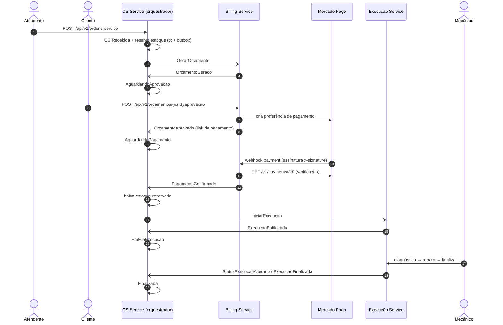
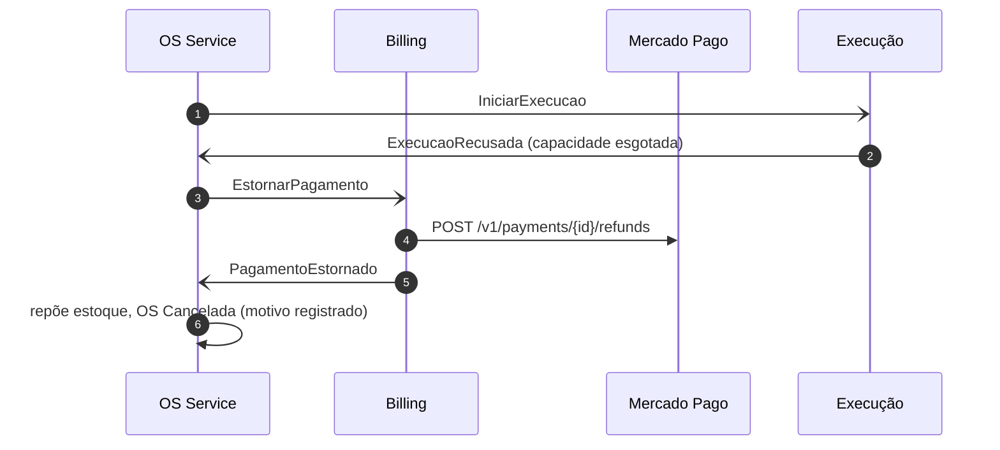

# Fase 4 — Design Arquitetural (microsserviços + Saga)

**Data:** 2026-11-16
**Enunciado:** `SOAT - Fase 4 - Tech challenge.pdf`
**Base:** os quatro repositórios da Fase 3 (ver `fase3-design-arquitetural.md`)

> Decisões marcadas com **(decisão)** foram tomadas pelo implementador seguindo a
> recomendação registrada aqui; o autor do projeto delegou essas escolhas.

---

## 1. Intenção

A oficina passou a operar em escala nacional, com várias filiais. A aplicação monolítica da
Fase 3 (`oficina-app`) vira **três microsserviços independentes**, cada um com repositório,
infraestrutura, banco e pipeline próprios. As transações que atravessam serviços — abrir a OS,
orçar, aprovar, pagar e executar — passam a ser coordenadas por uma **Saga orquestrada**, com
compensação segura em cada etapa que pode falhar.

### Objetivos (requisitos obrigatórios do enunciado)

1. ≥ 3 microsserviços, cada um com repositório, infraestrutura e banco de dados próprios.
2. Pelo menos um banco relacional e um banco não relacional.
3. Comunicação REST síncrona onde necessário e mensageria assíncrona para eventos e comandos.
4. Nenhum serviço acessa o banco de outro.
5. Saga Pattern com rollback/compensação em qualquer etapa; escolha justificada no README.
6. Testes unitários em todos os serviços, ≥ 80% de cobertura por serviço, um fluxo completo em BDD.
7. SonarQube (ou similar) no CI.
8. Pipeline independente por serviço: build, testes, qualidade, deploy automatizado em Kubernetes.
9. `main` protegida com PR obrigatório e checks.
10. Integração de pagamento com Mercado Pago.
11. Observabilidade da Fase 3 (New Relic) rastreando o fluxo distribuído.
12. Entregáveis: Dockerfile, manifests K8s, CI/CD, evidência de cobertura, arquitetura do
    serviço, Swagger/collection, vídeo ≤ 15 min, PDF de entrega.

### Não-objetivos

- Reescrever a autenticação: `oficina-lambda-auth` e o Lambda Authorizer seguem como estão.
- Service mesh (Istio), Kafka, CQRS com base de leitura própria, Event Sourcing.
- Timeout de aprovação por agendamento (cliente que nunca responde). Fica registrado como
  evolução; a OS pode ser cancelada manualmente.
- Front-end.

### Anti-objetivos (o que tornaria a entrega um fracasso mesmo "funcionando")

- **Monolito distribuído:** serviços que só funcionam juntos por chamadas síncronas em cadeia.
- **Compensação que não compensa:** estorno que não estorna no Mercado Pago, estoque que não
  volta, OS que fica presa em um status intermediário.
- **Contrato divergente em silêncio** entre repositórios (lição da Fase 3): nome de fila,
  URN de mensagem ou formato de campo diferentes entre produtor e consumidor.
- Cobertura de 80% alcançada com testes que não exercitam a saga.

---

## 2. Abordagens consideradas

### 2.1 Saga — orquestração × coreografia

| Abordagem | Prós | Contras |
|---|---|---|
| **Coreografia** (cada serviço reage a eventos do outro) | Sem ponto central; acoplamento fraco | Fluxo espalhado em 3 repositórios; risco de dependência cíclica (OS → Billing → OS → Execução → Billing para estorno); difícil de explicar e de testar ponta a ponta |
| **Orquestração com MassTransit State Machine no OS Service** ✅ | Fluxo e compensações em **um** lugar legível; participantes não conhecem a saga; dependências em mão única; testável com o test harness | Orquestrador é peça crítica (mitigado: estado persistido no PostgreSQL + outbox, réplicas no K8s) |
| AWS Step Functions | Gerenciado, visual | Lógica fora do código .NET, difícil de cobrir com testes/BDD no CI, custo e acoplamento à AWS |

**(decisão) Orquestração**, com o orquestrador dentro do OS Service — mesma forma das aulas
práticas (o orquestrador mora no serviço de pedido). Justificativa (Aula 2, Richardson): a
saga da OS tem 4 participantes lógicos, 3 pontos de falha e compensações em cascata, e
"nos cenários diferentes de sagas simples a orquestração tende a ser mais benéfica".

### 2.2 Mensageria

| Opção | Avaliação |
|---|---|
| RabbitMQ no cluster | Usado nas aulas; exigiria operar um StatefulSet no EKS |
| **Amazon SNS + SQS via MassTransit** ✅ | Gerenciado, custo praticamente zero, usado nas aulas de microsserviços (SQS + LocalStack); localmente roda no LocalStack |
| Kafka/MSK | Caro e desproporcional |

**(decisão) MassTransit 8.x** (licença Apache 2.0; a v9 é comercial) com transporte
**Amazon SQS/SNS**. Testes usam o `InMemoryTestHarness`/`AddMassTransitTestHarness`. O
transporte é escolhido por configuração (`Mensageria__Transporte = AmazonSqs | InMemory`).

### 2.3 Divisão em serviços

| Opção | Avaliação |
|---|---|
| Os 3 sugeridos no enunciado (OS, Billing, Execução) ✅ | Mapeia direto nas áreas do desafio (atendimento, cobrança, execução); Billing isola a integração externa (Mercado Pago) |
| Separar também Clientes/Catálogo/Estoque | 5–6 serviços para um projeto solo; mais repositórios do que o domínio pede agora |

**(decisão)** Três serviços. Clientes, veículos, catálogo e estoque **permanecem no OS
Service** (são o contexto de atendimento e a origem dos preços); a evolução natural para um
serviço de Catálogo/Estoque fica registrada.

### 2.4 Bancos

| Serviço | Banco | Por quê |
|---|---|---|
| OS Service | **PostgreSQL 16 (RDS, `oficina-infra-db`)** | Domínio relacional (cliente↔veículo↔OS↔itens↔peças), saldo de estoque com transação serializável, estado da saga + outbox na mesma transação |
| Billing Service | **Amazon DynamoDB** | Orçamento e pagamento são documentos por OS (itens embutidos, como o exemplo de fatura da aula de MongoDB); acesso sempre por chave; escrita condicional garante idempotência dos webhooks do Mercado Pago |
| Execução Service | **Amazon DynamoDB** | Fila de execução = acesso por chave e por status/data (GSI); escrita condicional (`attribute_not_exists`, versão) dá exatamente-uma-vez por OS e lock otimista nas transições |

**(decisão)** DynamoDB em vez de MongoDB/DocumentDB: on-demand custa centavos, já é usado na
Fase 3 (rate limiting da Lambda), não exige cluster nem VPC endpoint e tem DynamoDB Local /
LocalStack para testes. DocumentDB custaria ~US$ 60/mês no menor porte.

---

## 3. Topologia dos repositórios

| Repositório | Papel na Fase 4 | Estado |
|---|---|---|
| `oficina-app` | **OS Service** (evolução do monólito) + documentação central | existe — evolui |
| `oficina-billing-service` | Orçamento e pagamento (Mercado Pago) | **novo** |
| `oficina-execucao-service` | Fila de execução, diagnóstico e reparo | **novo** |
| `oficina-lambda-auth` | Autenticação (inalterado) | existe |
| `oficina-infra-k8s` | VPC, EKS, NLB, API Gateway, New Relic; publica novos parâmetros SSM; painéis/alertas da saga | existe — ajustes |
| `oficina-infra-db` | RDS do OS Service (inalterado) | existe |

**(decisão)** O repositório `oficina-app` **não é renomeado**: os links da entrega da Fase 3
continuam válidos; o README passa a apresentá-lo como "OS Service".

Cada serviço novo segue a mesma estrutura do `oficina-app` (Clean Architecture enxuta):
`Dominio`, `Aplicacao`, `Infraestrutura`, `Api`, testes, `Dockerfile`, `k8s/`, `terraform/`,
`.github/workflows/ci.yml` e `cd.yml`, `docs/`, `http/`.

### Infraestrutura própria de cada serviço (`terraform/` no repositório do serviço)

- Repositório ECR do serviço.
- Tabelas DynamoDB (Billing e Execução).
- Role IAM para os pods (IRSA, OIDC do EKS) com permissão em SNS/SQS de prefixo `oficina-`,
  nas tabelas do próprio serviço e no segredo do próprio serviço.
- Target group + listener no NLB compartilhado (porta própria) e integração + rotas no API
  Gateway compartilhado, lidos do SSM publicado pelo `oficina-infra-k8s`.
- Segredos no Secrets Manager (Billing: `access_token` e `webhook_secret` do Mercado Pago).

Contrato com `oficina-infra-k8s` continua por SSM, nunca por `terraform_remote_state`.
Parâmetros novos que o `oficina-infra-k8s` passa a publicar: ARN do NLB, ARN do SG do NLB,
ID do SG do VPC Link, nome do(s) Auto Scaling Group(s) dos nós, OIDC provider ARN/URL do EKS,
ID do Lambda Authorizer (já existe no `oficina-lambda-auth` — confirmar origem no plano).

---

## 4. Saga da Ordem de Serviço

### 4.1 Novo ciclo de vida da OS

```
Recebida ──► AguardandoAprovacao ──► AguardandoPagamento ──► EmFilaExecucao
                                                                  │
            Cancelada ◄── (qualquer falha / rejeição)             ▼
                                         EmDiagnostico ──► EmReparo ──► Finalizada ──► Entregue
```

O diagnóstico agora acontece **depois** da aprovação/pagamento, como no exemplo do enunciado
(abrir OS → gerar orçamento → aguardar aprovação → enviar para execução). O orçamento é
gerado a partir dos itens informados na abertura (serviços e peças do catálogo, com preço
snapshot — ADR-005 continua valendo).

### 4.2 Passos, transações compensatórias e tipo de cada passo

| # | Passo | Serviço | Falha possível | Compensação |
|---|---|---|---|---|
| 1 | Abrir OS (Recebida) + reservar estoque das peças | OS | estoque insuficiente → 422 síncrono, saga nem começa | — |
| 2 | Gerar orçamento | Billing | erro de validação no Billing | OS: liberar reserva de estoque, OS → Cancelada |
| 3 | Cliente aprova/rejeita o orçamento | Billing (API) | **rejeição** | Billing: orçamento Rejeitado; OS: liberar reserva, OS → Cancelada |
| 4 | Criar cobrança no Mercado Pago e aguardar confirmação | Billing | pagamento recusado / expirado | Billing: orçamento Cancelado; OS: liberar reserva, OS → Cancelada |
| 5 | Baixar estoque reservado (confirmação da reserva) | OS | — (reserva já garantida) | (no passo 6) repor estoque |
| 6 | Enfileirar execução | Execução | fila recusa (capacidade da filial esgotada, OS duplicada inválida) | Billing: **estornar pagamento** no Mercado Pago; OS: repor estoque, OS → Cancelada |
| 7 | Diagnóstico, reparo, finalização | Execução → OS | — (passos após o pivô são *retriable*) | — |

Terminologia (Richardson, citada nas aulas): passos 1–4 e 6 são **compensáveis**; a entrada
na fila (6) é o **pivô**; 7 é **retriable** (só avança, com retry).

**Contramedidas para a falta do "I" (Aula 3):**
- *Semantic lock / pessimistic view:* o estoque é **reservado** na abertura (saldo reservado
  separado do saldo disponível) e só **baixado** após o pagamento; outra OS nunca lê saldo que
  pode ser devolvido. A OS fica em status intermediário que bloqueia edição de itens enquanto a
  saga corre.
- *Reread value / lock otimista:* agregados com versão (`xmin` no PostgreSQL, atributo
  `versao` com escrita condicional no DynamoDB).
- **Idempotência:** cada consumidor tolera mensagem duplicada (SQS é *at-least-once*):
  estado da saga por `CorrelationId = OrdemServicoId`; Billing e Execução usam escrita
  condicional; webhook do Mercado Pago deduplicado por `payment_id`.
- **Transactional Outbox:** OS Service usa o outbox do MassTransit com EF Core (mensagem e
  estado da saga gravados na mesma transação PostgreSQL). Billing e Execução gravam no
  DynamoDB **antes** de publicar e republicam com segurança porque o consumidor é idempotente
  (registro do motivo no README: DynamoDB não compartilha transação com SQS).

### 4.3 Diagrama de sequência — caminho feliz



### 4.4 Diagrama — falha na execução (compensação em cascata)



### 4.5 Máquina de estados da saga (OS Service, `OrdemServicoSaga`)

Estados: `AguardandoOrcamento`, `AguardandoAprovacao`, `AguardandoPagamento`,
`AguardandoExecucao`, `EmExecucao`, `Compensando`, `Concluida` (final), `Cancelada` (final).
Dados da saga: `CorrelationId` (= OrdemServicoId), `NumeroOs`, `PagamentoId`, `Motivo`,
`CriadaEm`, `AtualizadaEm`, `Versao`. Persistida no schema `saga` do PostgreSQL do OS Service.

---

## 5. Contratos de mensagens (entre repositórios)

**Este é o contrato que falha em silêncio se divergir.** Cada repositório declara as próprias
classes de mensagem (sem pacote compartilhado — um pacote NuGet comum acoplaria os deploys),
com o **mesmo URN** via `[MessageUrn("oficina:saga:<Nome>")]` e `[ExcludeFromTopology]` quando
aplicável. Cada repositório tem **testes de contrato** que serializam suas mensagens e
comparam com os exemplos JSON versionados em `docs/contratos/mensagens/*.json`, idênticos nos
três repositórios (o CI de cada um falha se o JSON divergir do tipo).

Todas carregam `OrdemServicoId` (Guid, correlação), `OcorridoEm` (UTC). Valores monetários em
`decimal` serializado como número. Enumerações como string.

| URN | Tipo | Produtor → Consumidor | Campos adicionais |
|---|---|---|---|
| `oficina:saga:GerarOrcamento` | comando | OS → Billing | `NumeroOs`, `ClienteDocumento`, `ClienteNome`, `ClienteEmail?`, `Itens[] {Tipo: Servico\|Peca, ReferenciaId, Descricao, Quantidade, PrecoUnitario}` |
| `oficina:saga:OrcamentoGerado` | evento | Billing → OS | `OrcamentoId`, `ValorTotal` |
| `oficina:saga:OrcamentoFalhou` | evento | Billing → OS | `Motivo` |
| `oficina:saga:OrcamentoAprovado` | evento | Billing → OS | `OrcamentoId`, `LinkPagamento` |
| `oficina:saga:OrcamentoRejeitado` | evento | Billing → OS | `OrcamentoId`, `Motivo?` |
| `oficina:saga:PagamentoConfirmado` | evento | Billing → OS | `PagamentoId`, `Valor`, `Meio` |
| `oficina:saga:PagamentoRecusado` | evento | Billing → OS | `PagamentoId?`, `Motivo` |
| `oficina:saga:EstornarPagamento` | comando | OS → Billing | `Motivo` |
| `oficina:saga:PagamentoEstornado` | evento | Billing → OS | `PagamentoId`, `Valor` |
| `oficina:saga:EstornoFalhou` | evento | Billing → OS | `Motivo` (OS fica em `Compensando` + alerta Critical; intervenção manual) |
| `oficina:saga:CancelarOrcamento` | comando | OS → Billing | `Motivo` (cancelamento manual da OS antes do pagamento) |
| `oficina:saga:IniciarExecucao` | comando | OS → Execução | `NumeroOs`, `Unidade`, `Servicos[] {Descricao, Quantidade}`, `Pecas[] {Descricao, Quantidade}` |
| `oficina:saga:ExecucaoEnfileirada` | evento | Execução → OS | `PosicaoFila` |
| `oficina:saga:ExecucaoRecusada` | evento | Execução → OS | `Motivo` |
| `oficina:saga:StatusExecucaoAlterado` | evento | Execução → OS | `StatusExecucao: EmDiagnostico\|EmReparo`, `Observacao?` |
| `oficina:saga:ExecucaoFinalizada` | evento | Execução → OS | `Observacao?`, `DuracaoMinutos` |

Comandos usam *send* para a fila do serviço destino (`oficina-billing-comandos`,
`oficina-execucao-comandos`); eventos usam *publish* (tópico SNS por tipo; o OS Service assina
com a fila `oficina-os-saga`). Nomes de filas/tópicos com prefixo do ambiente
(`hml-`/`prd-`), porque os dois namespaces compartilham a conta.

---

## 6. Serviços

### 6.1 OS Service (`oficina-app`)

- Mantém: clientes, veículos, catálogo de serviços, peças/estoque, consulta, `me/*`, métricas,
  `auth.usuario` (lido pela Lambda), historico_status, evento New Relic de transição.
- Muda: abertura da OS inicia a saga; estoque ganha **reserva** (reservar/confirmar/liberar);
  endpoints de transição que agora pertencem a outros serviços são removidos
  (`enviar-orcamento`, webhook de decisão, `iniciar-execucao`, `finalizar`) — a OS só muda de
  status pela saga, exceto `entregar` e `cancelar` (atendente).
- Novo: `GET /api/v1/ordens-servico/{id}/saga` (estado e trilha da saga, para a demo).
- MassTransit + EF Core saga repository + bus outbox; consumidores dos eventos da execução.

### 6.2 Billing Service (`oficina-billing-service`)

- `Orcamento` (agregado): itens, total, status `Gerado → Aprovado|Rejeitado|Cancelado`.
- `Pagamento`: `Pendente → Aprovado|Recusado → Estornado`.
- API: `GET /api/v1/orcamentos/{osId}` (Cliente dono do documento ou Atendente),
  `POST /api/v1/orcamentos/{osId}/aprovacao` e `/rejeicao` (Cliente dono ou Atendente),
  `POST /webhooks/mercadopago` (público no API Gateway; valida `x-signature` HMAC-SHA256),
  `GET /api/v1/pagamentos/{osId}`.
- Porta `IGatewayPagamento` com dois adaptadores **(decisão)**:
  - `MercadoPagoGateway` — API REST do Mercado Pago (Checkout Pro: `POST /checkout/preferences`
    com `external_reference = osId`; verificação `GET /v1/payments/{id}`; estorno
    `POST /v1/payments/{id}/refunds`), credenciais de teste (sandbox).
  - `GatewayPagamentoSimulado` — para testes, ambiente local e demonstração de falha; ativado
    por `Pagamento__Modo=Simulado`; expõe `POST /api/v1/simulador/pagamentos/{osId}` com
    `{ "resultado": "aprovado" | "recusado" }` (registrado só nesse modo, perfil Admin).
- DynamoDB: tabela `oficina-billing-<amb>` com `pk = OS#<osId>`, `sk = ORCAMENTO | PAGAMENTO#<id>`;
  `WEBHOOK#<paymentId>` para deduplicação.

### 6.3 Execução Service (`oficina-execucao-service`)

- `Execucao` (agregado): `NaFila → EmDiagnostico → EmReparo → Finalizada`; `Recusada`.
- Regra de capacidade por unidade (`Execucao__CapacidadeMaximaPorUnidade`, padrão 20 OS
  ativas) — é o ponto de falha real do pivô e, na demo, é reduzida a 0 para forçar a
  compensação em cascata.
- API (perfil Atendente/Admin = mecânico): `GET /api/v1/execucoes?status=`,
  `GET /api/v1/execucoes/{osId}`, `POST /api/v1/execucoes/{osId}/diagnostico`,
  `/reparo`, `/finalizacao`.
- DynamoDB: tabela `oficina-execucao-<amb>`, `pk = osId`, GSI `status-enfileiradaEm`; contador
  de ativas por unidade com escrita condicional.

### 6.4 Exposição HTTP

API Gateway HTTP API da Fase 3, mesma autorização (Lambda Authorizer valida o JWT; cada serviço
revalida). Rotas:

| Rota | Destino | Autorização |
|---|---|---|
| `ANY /api/v1/{proxy+}` (existente) | OS Service | Authorizer |
| `ANY /billing/api/v1/{proxy+}` | Billing | Authorizer |
| `POST /billing/webhooks/mercadopago` | Billing | nenhuma (assinatura MP) |
| `ANY /execucao/api/v1/{proxy+}` | Execução | Authorizer |

Os serviços novos usam `PathBase` (`/billing`, `/execucao`) para que o Swagger funcione atrás
do gateway.

---

## 7. Testes e qualidade

- **Unitários** (xUnit, FluentAssertions, Moq) em domínio, aplicação e adaptadores de cada
  serviço; **cobertura ≥ 80% por serviço**, gate no CI (mesmo script da Fase 3).
- **BDD** com **Reqnroll** (sucessor open source do SpecFlow citado na aula), Gherkin em
  português (`# language: pt`):
  - OS Service — `FluxoCompletoOrdemServico.feature`: caminho feliz até `Finalizada`,
    rejeição do orçamento, pagamento recusado e falha da execução com estorno; roda a saga real
    com o test harness do MassTransit simulando os participantes nas filas.
  - Billing — aprovação → pagamento aprovado/recusado → estorno.
  - Execução — enfileirar → diagnóstico → reparo → finalização; recusa por capacidade.
- **Testes de contrato** de mensagens (seção 5) nos três repositórios.
- **Integração:** Testcontainers (PostgreSQL no OS Service; DynamoDB Local nos outros).
- **SonarCloud** (SonarQube como serviço, gratuito para repositório público) via
  `dotnet-sonarscanner`, com cobertura OpenCover; quality gate no PR. O job roda quando o
  secret `SONAR_TOKEN` existe e emite aviso quando não existe (para não bloquear forks).
- CodeQL e Dependabot como na Fase 3.

## 8. CI/CD

Igual ao `oficina-app` da Fase 3 em cada repositório: `develop` → `oficina-hml`,
`main` → `oficina-prd`; OIDC (sem chaves estáticas); build → testes + cobertura → Sonar →
`docker build` → push ECR → `kubectl apply` + `rollout status`. Workflow `infra.yml`
separado para o `terraform/` do serviço (plan em PR, apply manual via `workflow_dispatch`).
Branches `main` e `develop` protegidas com PR, 1 aprovação e checks obrigatórios.

## 9. Observabilidade

- Agente New Relic .NET em cada imagem (mesmo padrão da Fase 3; liga por variável no
  Deployment). O agente instrumenta MassTransit → **trace distribuído** atravessando SQS.
- Correlação de logs por `OrdemServicoId` + `X-Correlation-Id`.
- Evento customizado `SagaOrdemServico` (`passo`, `resultado`, `compensacao`, `duracaoMs`) no
  OS Service; Billing e Execução emitem `PagamentoEvento` e `ExecucaoEvento`.
- `oficina-infra-k8s/terraform/newrelic`: novo dashboard "Saga da OS" (sagas por estado,
  compensações por motivo, tempo por passo, throughput por serviço, mapa de serviços) e alertas
  (compensação disparada, `EstornoFalhou` = Critical, fila DLQ com mensagens).

## 10. Desenvolvimento local e demonstração

- Cada serviço tem `docker/docker-compose.yml` com suas dependências (PostgreSQL ou DynamoDB
  Local) + LocalStack (SNS/SQS).
- `oficina-app/docker/docker-compose.fase4.yml` sobe os três serviços + PostgreSQL +
  LocalStack para o fluxo ponta a ponta local; roteiro `http/fase4-demo.http` cobre caminho
  feliz e as três falhas.

## 11. Bloqueios externos (dependem do autor)

- Credenciais AWS para bootstrap/apply (nada da Fase 3 consta aplicado).
- Conta SonarCloud (org + `SONAR_TOKEN` nos três repositórios).
- Credenciais de teste do Mercado Pago (access token de teste + segredo do webhook).
- Conta New Relic (license key) — já prevista na Fase 3.

Todo o resto é construído e validado sem esses itens (CI verde, `terraform validate`,
fluxo completo local com o gateway simulado).

## 12. Ordem de execução

1. Contratos de mensagens (este documento + JSONs de exemplo).
2. OS Service (`oficina-app`) — saga, reserva de estoque, remoção dos endpoints migrados, BDD.
3. Billing Service — novo repositório.
4. Execução Service — novo repositório.
5. `oficina-infra-k8s` — parâmetros SSM novos, dashboard e alertas da saga.
6. Compose ponta a ponta, roteiro de demo, READMEs, RFC-006/ADRs da Fase 4, rascunho do PDF.

## 13. O que fica para o implementador

Nomes internos de classes, layout exato de pastas dentro de cada camada, valores de timeout e
retry do MassTransit (padrão: retry exponencial 3x + redelivery), formato do Swagger. Tudo o
que cruza fronteira de repositório (seção 5 e 6.4) **não** fica — está fixado aqui.
