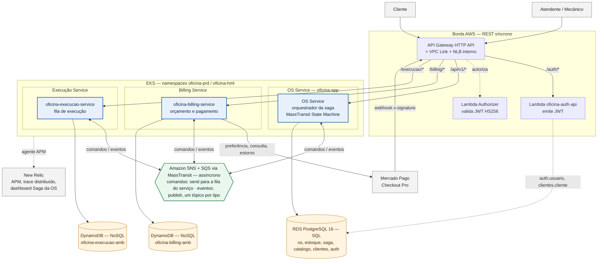
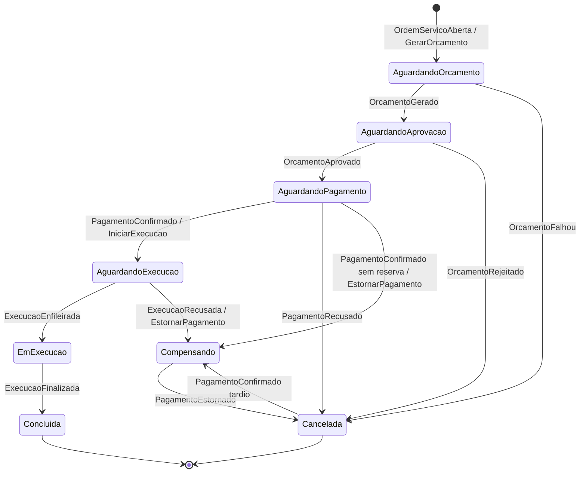

# Tech Challenge — Fase 4 — Documento de Entrega

**Curso:** Pós-Tech FIAP — Arquitetura de Software (15SOAT)**Tema:** Sistema Integrado de Atendimento e Execução de Serviços para Oficina Mecânica — microsserviços e Saga Pattern**Data do documento:** 17/11/2026

> Itens marcados com `[PENDENTE: ...]` dependem de ações externas (credenciais AWS, contas de
> terceiros, gravação do vídeo). Tudo o mais reflete o estado real dos repositórios em
> 17/11/2026. **Nada da Fase 4 (nem da Fase 3) foi aplicado na AWS ainda:** a infraestrutura
> está escrita em Terraform e validada no CI (`terraform validate`), e o fluxo ponta a ponta
> roda localmente (Docker Compose + LocalStack).

---

## 1. Equipe

| Nome | Discord |
|---|---|
| Thiago Fernandes da Cruz | @thiago_64271 |

Os seis repositórios são **públicos**. O usuário **`soat-architecture`** é colaborador do
`oficina-app`. [PENDENTE: convidar `soat-architecture` também no `oficina-billing-service` e no
`oficina-execucao-service`]

---

## 2. Links

### Repositórios

| Repositório | Papel na Fase 4 | Banco | PR da Fase 4 |
|---|---|---|---|
| https://github.com/lcr-thiago-fernandes/oficina-app | **OS Service** (atendimento, estoque, OS, orquestrador da saga) + documentação central | PostgreSQL 16 (RDS) | [#41](https://github.com/lcr-thiago-fernandes/oficina-app/pull/41) |
| https://github.com/lcr-thiago-fernandes/oficina-billing-service | **Billing Service** (orçamento, aprovação, pagamento e estorno no Mercado Pago) | DynamoDB | [#1](https://github.com/lcr-thiago-fernandes/oficina-billing-service/pull/1) |
| https://github.com/lcr-thiago-fernandes/oficina-execucao-service | **Execução Service** (fila de execução por unidade, diagnóstico, reparo, finalização) | DynamoDB | [#1](https://github.com/lcr-thiago-fernandes/oficina-execucao-service/pull/1) |
| https://github.com/lcr-thiago-fernandes/oficina-infra-k8s | Plataforma compartilhada: VPC, EKS, NLB, API Gateway, New Relic; na Fase 4, parâmetros SSM novos, dashboard e alertas da saga, alarmes das filas `_error` | — | [#21](https://github.com/lcr-thiago-fernandes/oficina-infra-k8s/pull/21) |
| https://github.com/lcr-thiago-fernandes/oficina-infra-db | RDS PostgreSQL do OS Service | — | inalterado na Fase 4 |
| https://github.com/lcr-thiago-fernandes/oficina-lambda-auth | Lambda de autenticação (CPF e usuário/senha) e Lambda Authorizer | — | inalterado na Fase 4 |

Os quatro PRs da Fase 4 estão abertos contra `develop`, com todos os checks verdes
(build, testes com gate de cobertura, Sonar, CodeQL, build da imagem, validação do Terraform).
[PENDENTE: merge `develop` → `main` após aprovação]

### Documentação e demais links

| Item | Link |
|---|---|
| Vídeo de demonstração (≤ 15 min, YouTube ou Vimeo) | [PENDENTE: link do vídeo] |
| Design arquitetural da Fase 4 | [fase4-design-arquitetural.md](https://github.com/lcr-thiago-fernandes/oficina-app/blob/feature/fase4-os-service/docs/arquitetura/fase4-design-arquitetural.md) |
| RFC-006 — Microsserviços e Saga orquestrada | [RFC-006](https://github.com/lcr-thiago-fernandes/oficina-app/blob/feature/fase4-os-service/docs/rfc/RFC-006-microsservicos-saga-orquestrada.md) |
| ADRs da Fase 4 (021 a 026) | [docs/arquitetura](https://github.com/lcr-thiago-fernandes/oficina-app/tree/feature/fase4-os-service/docs/arquitetura) |
| Contratos de mensagens da saga (16 JSONs, idênticos nos três serviços) | [docs/contratos/mensagens](https://github.com/lcr-thiago-fernandes/oficina-app/tree/feature/fase4-os-service/docs/contratos/mensagens) |
| Swagger | OS `/swagger`, Billing `/billing/swagger`, Execução `/execucao/swagger` |
| Coleções `.http` | [`http/fase4-demo.http`](https://github.com/lcr-thiago-fernandes/oficina-app/blob/feature/fase4-os-service/http/fase4-demo.http) (roteiro ponta a ponta), `http/billing.http`, `http/execucao.http` |
| URL do API Gateway | [PENDENTE: depende do apply na AWS] |
| Dashboard New Relic "Saga da OS" | [PENDENTE: depende da conta New Relic e do deploy] |

(Os links de documentação apontam para a branch `feature/fase4-os-service`; depois do merge,
o mesmo caminho vale em `main`.)

---

## 3. Diagrama geral da arquitetura



**Comunicação.** REST síncrono **só na borda**: atendente, cliente, mecânico e o webhook do
Mercado Pago entram pelo API Gateway (Lambda Authorizer valida o JWT; cada serviço revalida).
**Entre os serviços, só mensageria assíncrona** (Amazon SNS + SQS via MassTransit): nenhum
serviço chama outro por HTTP e **nenhum acessa o banco de outro**. A Lambda de autenticação
lê `auth.usuario` e `clientes.cliente` do PostgreSQL do OS Service por contrato da Fase 3,
inalterado.

**Bancos (um por serviço).** OS Service: PostgreSQL 16 no RDS (relacional, SQL). Billing e
Execução: uma tabela DynamoDB cada (não relacional, NoSQL).

**Exposição HTTP e portas fixadas (NodePort / listener do NLB compartilhado):**

| Serviço | prd | hml | Rotas no API Gateway |
|---|---|---|---|
| OS Service | 30080 / 80 | 30081 / 81 | `ANY /api/v1/{proxy+}` (Authorizer) |
| Billing | 30082 / 8081 | 30083 / 8082 | `ANY /billing/api/v1/{proxy+}` (Authorizer), `POST /billing/webhooks/mercadopago` (sem Authorizer, assinatura do Mercado Pago) |
| Execução | 30084 / 8083 | 30085 / 8084 | `ANY /execucao/api/v1/{proxy+}` (Authorizer) |

Como na Fase 3, só `prd` é ligado ao API Gateway; `hml` fica acessível apenas dentro da VPC.

**Filas e tópicos** (prefixo `local` | `hml` | `prd`): `{prefixo}-oficina-billing-comandos`,
`{prefixo}-oficina-execucao-comandos`, `{prefixo}-oficina-os-saga` (eventos para a saga) e um
tópico SNS por mensagem, `{prefixo}-oficina-saga-{Nome}`. Falhas definitivas vão para a fila
`<endpoint>_error`, monitorada por alarme.

---

## 4. Saga Pattern — estratégia escolhida: **orquestração**

### 4.1 Por que orquestração

| Abordagem | Prós | Contras |
|---|---|---|
| Coreografia (cada serviço reage aos eventos do outro) | Sem ponto central; acoplamento fraco | Fluxo espalhado em 3 repositórios; dependência cíclica (OS → Billing → OS → Execução → Billing para o estorno); difícil de explicar e de testar ponta a ponta |
| **Orquestração com MassTransit State Machine no OS Service** ✅ | Fluxo e compensações em **um** lugar legível; participantes não conhecem a saga; dependências em mão única; testável com o test harness | Orquestrador é peça crítica (mitigado: estado persistido no PostgreSQL + outbox, réplicas no K8s) |
| AWS Step Functions | Gerenciado, visual | Lógica fora do código .NET, difícil de cobrir com testes/BDD no CI, custo e acoplamento à AWS |

A saga da OS tem **4 participantes lógicos** (OS, Billing, Mercado Pago via Billing, Execução),
**3 pontos de falha** depois da abertura e uma **compensação em cascata** (execução recusada →
estornar no Mercado Pago → repor estoque → cancelar a OS). Fora das sagas simples, a
orquestração tende a ser mais benéfica (Richardson, citado na Aula 2). O orquestrador mora no
OS Service — como nas aulas práticas, em que ele fica no serviço do pedido — na classe
`OrdemServicoSaga` (MassTransit State Machine), com estado e trilha no schema `saga` do
PostgreSQL, correlacionados por `CorrelationId = OrdemServicoId`. Registro: RFC-006 e ADR-021.

### 4.2 Máquina de estados da `OrdemServicoSaga`



Caminho feliz: atendente abre a OS (`Recebida`, estoque **reservado**) → `GerarOrcamento` ao
Billing → `OrcamentoGerado` → cliente aprova no Billing (preferência criada no Mercado Pago) →
`OrcamentoAprovado` → webhook do Mercado Pago, verificado com `GET /v1/payments/{id}` →
`PagamentoConfirmado` → OS **baixa** o estoque reservado → `IniciarExecucao` → `ExecucaoEnfileirada`
→ mecânico registra diagnóstico, reparo e finalização na Execução → `ExecucaoFinalizada` → OS
`Finalizada` (saga `Concluida`); o atendente entrega o veículo (`Entregue`).

### 4.3 Passos e compensações

| # | Passo | Serviço | Falha possível | Compensação |
|---|---|---|---|---|
| 1 | Abrir OS (`Recebida`) + reservar estoque das peças | OS | saldo disponível insuficiente | 422 síncrono; nada vai para o outbox, a saga nem começa |
| 2 | Gerar orçamento (`GerarOrcamento` → `OrcamentoGerado`) | Billing | `OrcamentoFalhou` (validação no Billing) | OS: libera a reserva, OS → `Cancelada` |
| 3 | Cliente aprova/rejeita o orçamento | Billing (API) | `OrcamentoRejeitado` | Billing: orçamento `Rejeitado`; OS: libera a reserva, OS → `Cancelada` |
| 4 | Cobrança no Mercado Pago e confirmação | Billing | `PagamentoRecusado` (recusado/expirado) | Billing: cancela o orçamento; OS: libera a reserva, OS → `Cancelada` |
| 5 | Baixar o estoque reservado | OS | reserva já desfeita (cancelamento processado antes do pagamento) | nada é baixado; `EstornarPagamento` → saga `Compensando` → `PagamentoEstornado` → OS `Cancelada` |
| 6 | Enfileirar execução — **pivô** | Execução | `ExecucaoRecusada` (capacidade da unidade esgotada) | Billing: **estorna** no Mercado Pago (`EstornarPagamento` → `PagamentoEstornado`); OS: **repõe** o estoque, OS → `Cancelada` |
| 7 | Diagnóstico, reparo, finalização | Execução → OS | — (após o pivô os passos são *retriable*) | — |
| — | Cancelamento pelo atendente (só antes do pagamento) | OS | — | `CancelarOrcamento` ao Billing; OS: libera a reserva, OS → `Cancelada` |
| — | Pagamento confirmado depois do cancelamento | OS | — | `EstornarPagamento`: o dinheiro é devolvido, não perdido |

Se o próprio estorno falhar (`EstornoFalhou`), a saga fica em `Compensando`, registra
`CompensacaoFalhou` e um alerta **Critical** do New Relic pede intervenção manual
(limitação documentada).

### 4.4 Garantias (a saga não tem o "I" de ACID)

- **Reserva de estoque como *semantic lock*** (ADR-025): a abertura reserva (saldo reservado
  separado do disponível) e o estoque só é baixado depois do pagamento; outra OS nunca lê um
  saldo que pode voltar.
- **Versão otimista**: `xmin` no PostgreSQL; atributo `versao` com escrita condicional no DynamoDB.
- **Transactional Outbox no OS Service** (ADR-024): mensagem, estado da saga e efeitos no
  domínio na mesma transação PostgreSQL; inbox do MassTransit deduplica mensagens.
- **Idempotência nos participantes**: Billing e Execução gravam no DynamoDB **antes** de
  publicar, com escrita condicional (`attribute_not_exists`, `versao = :v`); o webhook do
  Mercado Pago é deduplicado por `payment_id`. DynamoDB não compartilha transação com o SQS,
  por isso não há outbox nesses dois serviços.
- **Contratos sem pacote compartilhado**: cada repositório declara as próprias classes com o
  mesmo URN (`oficina:saga:<Nome>`) e nome de entidade (`oficina-saga-<Nome>`); testes de
  contrato no CI de cada serviço comparam com os 16 JSONs versionados.
- Retry: 3 tentativas exponenciais dentro de redelivery atrasado; falha definitiva vai para a
  fila `_error` (alarme).

### 4.5 Fluxos de falha demonstráveis

| Cenário | Como provocar (ambiente local) | Resultado esperado |
|---|---|---|
| (B) Orçamento rejeitado | Cliente chama `POST /billing/api/v1/orcamentos/{osId}/rejeicao` | OS `Cancelada`, reserva de estoque liberada |
| (C) Pagamento recusado | Admin chama `POST /billing/api/v1/simulador/pagamentos/{osId}` com `{"resultado":"recusado"}` | OS `Cancelada`, reserva liberada |
| (D) Execução recusada (pivô) | Recriar a Execução com capacidade 0: `CAPACIDADE_EXECUCAO=0 docker compose -f docker/docker-compose.fase4.yml --env-file .env up -d --wait execucao-service` | `ExecucaoRecusada` → `EstornarPagamento` → `PagamentoEstornado` → estoque reposto, OS `Cancelada` |
| Falha do estorno (opcional) | Billing com `Pagamento__SimularFalhaEstorno=true` | `EstornoFalhou` depois dos retries; saga em `Compensando`, alerta Critical |

Estado e trilha de cada saga: `GET /api/v1/ordens-servico/{id}/saga`. No cluster, a falha da
execução é provocada com
`kubectl -n oficina-prd set env deployment/oficina-execucao Execucao__CapacidadeMaximaPorUnidade=0`.

---

## 5. Justificativa da divisão dos microsserviços e das tecnologias

| Decisão | Por quê | Alternativa descartada | Registro |
|---|---|---|---|
| **Três serviços: OS, Billing, Execução** | Mapeiam as três áreas do desafio (atendimento, cobrança, oficina) e têm ciclos e dados próprios; o Billing isola a integração externa (Mercado Pago). Clientes, veículos, catálogo e estoque ficam no OS Service: são o contexto de atendimento e a origem dos preços do orçamento | Separar também Clientes/Catálogo/Estoque (5–6 serviços para um projeto solo, sem ganho para o fluxo da OS) | RFC-006 §2.1 |
| **Saga orquestrada no OS Service** (MassTransit State Machine) | 4 participantes, 3 pontos de falha e compensação em cascata: fluxo e compensações num lugar só, testável no CI com o test harness e o BDD | Coreografia; AWS Step Functions | RFC-006 §2.2, ADR-021 |
| **Assíncrono entre serviços, REST só na borda** | Um serviço fora do ar não trava os outros: a mensagem espera na fila e a saga retoma | REST síncrono em cadeia (monolito distribuído, sem compensação) | RFC-006 §2.2 |
| **Amazon SNS + SQS via MassTransit 8.x** | Gerenciado (nada para operar no EKS), custo praticamente zero, LocalStack no ambiente local; MassTransit 8.x é Apache-2.0 e traz saga, outbox, retry e test harness | RabbitMQ no cluster (StatefulSet para operar); Kafka/MSK (caro e desproporcional); MassTransit 9 (licença comercial) | ADR-022 |
| **PostgreSQL 16 no OS Service** (SQL) | Domínio relacional (cliente ↔ veículo ↔ OS ↔ itens ↔ peças), reserva de estoque em transação `Serializable`, estado da saga e outbox na mesma transação do domínio | — (já era o banco da Fase 3; continua no RDS do `oficina-infra-db`) | ADR-023, ADR-002 |
| **DynamoDB no Billing e na Execução** (NoSQL) | Orçamento/pagamento e fila de execução são documentos por OS lidos por chave; escrita condicional dá idempotência e lock otimista; on-demand custa centavos | MongoDB/DocumentDB (cluster e VPC; ~US$ 60/mês no menor porte) | ADR-023 |
| **Outbox no OS Service, idempotência nos participantes** | Nenhuma mensagem da saga se perde nem é aplicada duas vezes | Publicar direto após o commit (perde mensagem se o processo cair no meio) | ADR-024 |
| **Reserva de estoque (*semantic lock*)** | Sem o "I" de ACID na saga, outra OS não pode ler um saldo que ainda pode voltar | Baixar na abertura e devolver na compensação (leitura de saldo sujo) | ADR-025 |
| **Mercado Pago Checkout Pro** atrás da porta `IGatewayPagamento` | Integração exigida pelo enunciado: preferência com `external_reference = osId`, verificação `GET /v1/payments/{id}`, estorno `POST /v1/payments/{id}/refunds`, webhook validado por `x-signature` (HMAC-SHA256). Um gateway **simulado** (`Pagamento__Modo=Simulado`) cobre testes, ambiente local e demonstração de falha | — | design §6.2 |
| **SonarQube no CI** (efêmero; SonarCloud com `SONAR_TOKEN`) | Análise real com quality gate em todo PR, sem depender de conta externa | Pular a análise sem token (CI verde sem análise) | ADR-026 |

**Mantidos da Fase 3:** AWS (EKS, RDS, API Gateway + Lambda Authorizer), C# 12 / .NET 8 com
Clean Architecture em todos os serviços, New Relic, Terraform e GitHub Actions com OIDC (sem
chaves estáticas). Cada serviço novo tem a mesma estrutura do `oficina-app` (`Dominio`,
`Aplicacao`, `Infraestrutura`, `Api`, testes, `Dockerfile`, `k8s/`, `terraform/`,
`.github/workflows/`, `docs/`, `http/`) e infraestrutura própria em `terraform/` (ECR,
tabela DynamoDB, role IRSA, target group + listener no NLB, rotas no API Gateway), lendo do
SSM os parâmetros publicados pelo `oficina-infra-k8s` — nunca `terraform_remote_state`.

| Camada | Tecnologia |
|---|---|
| Linguagem / Web | C# 12 / .NET 8, ASP.NET Core |
| Persistência | EF Core 8 + Npgsql (OS); AWS SDK DynamoDB (Billing, Execução) |
| Mensageria / saga | MassTransit 8.4.1 (OS, por exigir EF Core 8) e 8.5.12 (Billing, Execução) sobre SNS + SQS; LocalStack local |
| Pagamento | Mercado Pago Checkout Pro (API REST) + gateway simulado |
| Testes | xUnit, FluentAssertions, Moq, Coverlet, Testcontainers (PostgreSQL, DynamoDB Local, LocalStack), MassTransit test harness, Reqnroll (BDD em português) |
| Qualidade | SonarQube Community efêmero no CI / SonarCloud opcional, CodeQL, Dependabot |
| Plataforma | Docker, Kubernetes (AWS EKS, HPA, IRSA), API Gateway HTTP API, Terraform, GitHub Actions com OIDC |
| Observabilidade | Agente APM New Relic .NET (trace distribuído através do SQS), Serilog JSON, eventos customizados, dashboards e alertas como código |

---

## 6. Evidências de qualidade

### 6.1 Cobertura de testes (gate do CI: ≥ 80% de linha em cada serviço)

| Serviço | Testes | Cobertura de linha | Branch | Fonte |
|---|---|---|---|---|
| OS Service (`oficina-app`) | 732 (CI do PR #41) | **93,6%** (2640 de 2818 linhas) | 80,5% | README, `docs/evidencias/cobertura-Summary.txt`, [run 44082749518](https://github.com/lcr-thiago-fernandes/oficina-app/actions/runs/44082749518) |
| Billing Service | 308 | **96,9%** (1.176 de 1.213) | 90,5% | README, `docs/evidencias/cobertura-Summary.txt` |
| Execução Service | 165 | **96,6%** (802 de 830) | 87,5% | README, `docs/evidencias/cobertura-Summary.txt` |

No OS Service, as classes centrais da saga (`OrdemServicoSaga`, `SagaOrdemServicoGateway`,
`TopologiaSaga`, `RegistradorPassoSaga`) estão em 100%. O relatório HTML completo de cada
execução do CI fica no artefato `coverage-report`.

### 6.2 SonarQube (job `sonar` do CI; quality gate reprova o build se `ERROR`)

| Serviço | Execução | Quality Gate | Cobertura | Bugs / Vuln. / Hotspots | Code smells | Duplicação | Ratings |
|---|---|---|---|---|---|---|---|
| OS Service | [44082749518](https://github.com/lcr-thiago-fernandes/oficina-app/actions/runs/44082749518/job/134037248522) | `OK` | 89,3% | 0 / 0 / 0 | 10 | 2,1% | A / A / A |
| Billing | [44071898261](https://github.com/lcr-thiago-fernandes/oficina-billing-service/actions/runs/44071898261) | `OK` | 93,1% | 0 / 0 / 0 | 11 | 0% | A / A / A |
| Execução | [44067637664](https://github.com/lcr-thiago-fernandes/oficina-execucao-service/actions/runs/44067637664) | `OK` | 92,2% | 0 / 0 / 0 | 5 | 0% | A / A / A |

Sem conta SonarCloud, o job sobe um **SonarQube Community efêmero** como service container,
analisa com `dotnet-sonarscanner` (cobertura OpenCover) e publica o resumo no *job summary* e
no artefato `sonar-summary`; com o secret `SONAR_TOKEN`, a mesma análise vai para o SonarCloud
(ADR-026). A cobertura do Sonar difere da do ReportGenerator porque combina linha e branch.

### 6.3 BDD (Reqnroll, Gherkin em português)

| Serviço | Feature | Cenários |
|---|---|---|
| OS Service | `FluxoCompletoOrdemServico.feature` | Caminho feliz até `Finalizada`; cliente rejeita o orçamento; pagamento recusado; execução recusada dispara estorno e reposição de estoque |
| Billing | `FluxoPagamentoOrcamento.feature` | Cliente aprova e o pagamento é aprovado; aprova e o pagamento é recusado; pagamento aprovado é estornado quando a execução recusa a OS; cliente rejeita o orçamento |
| Execução | `FluxoExecucao.feature` | OS percorre a fila até a finalização e libera a vaga; unidade sem capacidade recusa a execução; comando duplicado não ocupa duas vagas |

O BDD do OS Service roda a API e a saga reais (PostgreSQL via Testcontainers), com o test
harness do MassTransit fazendo o papel do Billing e da Execução nas filas. Os três serviços
também têm **testes de contrato** de mensagens e testes de integração com DynamoDB Local e
LocalStack (Testcontainers).

### 6.4 CI/CD por repositório

| Repositório | CI (`ci.yml`) | Infra própria (`infra.yml`) | CD (`cd.yml`) |
|---|---|---|---|
| `oficina-app` | `build-test` (gate 80%), `format`, `sonar`, `docker-build`, `codeql`, `terraform-validate` | PR: fmt/validate · push: plan · `workflow_dispatch`: apply (role IRSA) | build → push ECR → Job de migração → `kubectl apply` + `rollout status`; `develop` → `oficina-hml`, `main` → `oficina-prd` |
| `oficina-billing-service` | `build-test` (gate 80%), `format`, `sonar`, `docker-build`, `codeql` | idem (ECR, DynamoDB, IRSA, segredos do Mercado Pago, NLB, rotas `/billing`) | imagem no ECR + deploy em `oficina-hml`/`oficina-prd`; pula com aviso enquanto `AWS_DEPLOY_ROLE_ARN` não existe |
| `oficina-execucao-service` | `build-test` (gate 80%), `format`, `sonar`, `docker-build`, `codeql` | idem (ECR, DynamoDB, IRSA, NLB, rotas `/execucao`) | imagem no ECR + deploy em `oficina-hml`/`oficina-prd` |
| `oficina-infra-k8s` | `terraform`, `terraform-newrelic`, `scripts`, `contratos` | — | `develop`: plan · `main`: apply (+ New Relic se habilitado) |

Todos os checks dos quatro PRs da Fase 4 estão verdes. Todos os pipelines usam **OIDC** (sem
chaves AWS estáticas); segredos de runtime vêm do Secrets Manager/SSM no deploy.

### 6.5 Branch protection

Script `scripts/setup-branch-protection.sh` em cada repositório (PR obrigatório, 1 aprovação,
checks obrigatórios, sem force-push). Estado consultado na API do GitHub em 17/11/2026, branch
`main`:

| Repositório | Checks obrigatórios hoje | Situação |
|---|---|---|
| `oficina-app` | `build-test`, `docker-build`, `codeql` | protegida; [PENDENTE: reaplicar o script para incluir `sonar` e `terraform-validate`] |
| `oficina-billing-service` | — | [PENDENTE: executar `scripts/setup-branch-protection.sh` (`main` e `develop` ainda sem proteção)] |
| `oficina-execucao-service` | `build-test`, `docker-build`, `codeql`, `sonar` | protegida |
| `oficina-infra-k8s` | `terraform`, `terraform-newrelic`, `scripts`, `contratos` | protegida |
| `oficina-infra-db` | `terraform`, `scripts`, `contratos` | protegida (Fase 3) |
| `oficina-lambda-auth` | `build-test`, `terraform`, `paridade-documento`, `codeql` | protegida (Fase 3) |

---

## 7. Observabilidade (New Relic, ferramenta da Fase 3)

- **Agente APM .NET** em cada imagem (liga pelo Deployment), instrumentando também o
  MassTransit: o **trace distribuído** atravessa o SQS entre os três serviços.
  `NEW_RELIC_APP_NAME`: `oficina-api`, `oficina-billing`, `oficina-execucao`.
- **Eventos customizados:** `SagaOrdemServico` a cada passo da saga (`ordemServicoId`,
  `numeroOs`, `passo`, `resultado` — `Sucesso`, `Falha`, `Compensado`, `CompensacaoFalhou`,
  `Ignorado` —, `compensacao`, `duracaoMs`, `estado`, `motivo`, `detalhe`); `PagamentoEvento`
  no Billing; `ExecucaoEvento` na Execução; `OrdemServicoEvento` da Fase 3 continua.
- **Correlação por `ordemServicoId`** em logs e transações APM. Para seguir uma OS de ponta a
  ponta: `SELECT * FROM SagaOrdemServico, PagamentoEvento, ExecucaoEvento WHERE ordemServicoId = '<id>'`.
- **Dashboard "Oficina Mecanica - Saga da OS"** (`oficina-infra-k8s/terraform/newrelic`):
  sagas por estado, passos por resultado, sagas compensadas por motivo, tempo por passo,
  duração da execução, pagamentos por etapa/resultado, execuções por status, throughput por
  serviço, trace distribuído por `ordemServicoId` e mapa de serviços.
- **Alertas** (política `Oficina-Prod`, além dos 5 da Fase 3):
  `Oficina-Saga-Prod-Compensacao-Warning`, `Oficina-Saga-Prod-CompensacaoFalhou-Critical`,
  `Oficina-Billing-Prod-EstornoFalhou-Critical`.
- **Alarmes de DLQ** (CloudWatch, `terraform/alarmes-dlq.tf`):
  `Oficina-Saga-Prod-DLQ-{os_saga,billing_comandos,execucao_comandos}-Critical` sobre
  `ApproximateNumberOfMessagesVisible` das filas `prd-oficina-*_error`, notificando o tópico SNS
  `oficina-alertas-dlq` por e-mail. CloudWatch em vez de New Relic porque a conta não tem a
  integração AWS do New Relic configurada e nenhum serviço emite evento quando a mensagem vai
  para a `_error`.

[PENDENTE: capturas do dashboard e de um alerta com dados reais — dependem da license key do
New Relic e do deploy na AWS.]

---

## 8. Como executar

### 8.1 Ponta a ponta local (os três serviços)

Com `oficina-app`, `oficina-billing-service` e `oficina-execucao-service` clonados lado a lado:

```bash
cd oficina-app
cp .env.example .env    # ADMIN_BOOTSTRAP_PASSWORD, JWT_SECRET (>= 32 caracteres)
docker compose -f docker/docker-compose.fase4.yml --env-file .env up -d --build --wait
./scripts/gerar-token-dev.sh Admin                 # token de gestão
./scripts/gerar-token-dev.sh Cliente 39053344705   # token do cliente dono das OS
```

Sobe PostgreSQL, DynamoDB Local, LocalStack (SNS/SQS) e os três serviços — OS em `:8080`,
Billing em `:8082/billing`, Execução em `:8083/execucao` —, com o Billing no modo de pagamento
simulado. O roteiro [`http/fase4-demo.http`](https://github.com/lcr-thiago-fernandes/oficina-app/blob/feature/fase4-os-service/http/fase4-demo.http)
(REST Client) percorre: (A) caminho feliz até a entrega; (B) orçamento rejeitado; (C)
pagamento recusado; (D) execução recusada com estorno. Para (D):

```bash
CAPACIDADE_EXECUCAO=0 docker compose -f docker/docker-compose.fase4.yml --env-file .env up -d --wait execucao-service
```

Testes de cada serviço: `dotnet test` na raiz do repositório (Docker em execução, por causa
dos Testcontainers).

### 8.2 Deploy na AWS (ordem obrigatória)

```
1. oficina-infra-k8s: scripts/bootstrap.sh  (re-executar: trust de oficina-gha-infra com os 5 repositórios)
2. oficina-infra-k8s                        → SSM novos, deploy role com /oficina/os-service/*, alarmes DLQ
3. oficina-infra-db                         → inalterado
4. oficina-lambda-auth                      → inalterado; publica /oficina/auth/lambda_authorizer_id
5. oficina-app (terraform/ via infra.yml)   → IRSA do OS Service; depois o CD
6. oficina-billing-service (terraform/)     → ECR, DynamoDB, IRSA, NLB 8081/8082, rotas /billing/*; depois o CD
7. oficina-execucao-service (terraform/)    → ECR, DynamoDB, IRSA, NLB 8083/8084, rotas /execucao/*; depois o CD
```

Cada CD roda ao promover `develop` → `main`. Destruição na ordem inversa. **Estado:** nada foi
aplicado na AWS; os pipelines estão prontos e verdes, e o primeiro `apply` real pode revelar
ajustes (registrado no README do `oficina-infra-k8s`).

---

## 9. Roteiro sugerido do vídeo (≤ 15 min)

| Tempo | Bloco | O que mostrar | Item do enunciado |
|---|---|---|---|
| 0:00–1:30 | Abertura | Equipe, os 6 repositórios, diagrama geral (seção 3): três serviços, bancos SQL e NoSQL, SNS/SQS | — |
| 1:30–3:00 | Decisão da saga | Tabela orquestração × coreografia, máquina de estados, `OrdemServicoSaga.cs` | Saga |
| 3:00–6:30 | Fluxo completo | `fase4-demo.http` parte (A): abrir OS → `GET .../saga` em `AguardandoAprovacao` → cliente aprova no Billing → pagamento (simulador) → Execução: diagnóstico, reparo, finalização → OS `Finalizada` → entregar. Mostrar a trilha da saga e as filas no LocalStack | Fluxo completo de uma OS pelos microsserviços |
| 6:30–9:30 | Falhas e compensação | Partes (B) rejeição e (C) pagamento recusado: reserva liberada; (D) capacidade 0 → `ExecucaoRecusada` → `EstornarPagamento` → `PagamentoEstornado` → estoque reposto, OS `Cancelada` | Execução do Saga Pattern e tratamento de falhas |
| 9:30–12:30 | CI/CD | Um PR (ex.: Execução #1): jobs `build-test` com gate de 80%, BDD, `sonar` com quality gate `OK`, `codeql`, `docker-build`; branch protection; `cd.yml` (ECR → `kubectl apply` → `rollout status`) | Deploy automatizado com validação de testes |
| 12:30–14:30 | Observabilidade | Dashboard "Saga da OS", trace distribuído por `ordemServicoId`, alertas de compensação e alarmes de DLQ (Terraform) | Monitoramento e rastreamento dos fluxos distribuídos |
| 14:30–15:00 | Fechamento | Limitações conhecidas e próximos passos | — |

[PENDENTE: o deploy real no EKS e o dashboard com dados dependem das credenciais AWS e da
license key do New Relic. Sem eles, o vídeo mostra o pipeline de CD e as definições do
dashboard/alertas como código, deixando isso explícito.]

---

## 10. Pendências externas

| Pendência | Depende de | Impacto |
|---|---|---|
| Credenciais AWS para `bootstrap.sh` e `apply` | autor | Sem deploy no EKS, sem URL do API Gateway; CDs pulam o deploy com aviso |
| Conta SonarCloud (`SONAR_TOKEN`, `SONAR_ORGANIZATION`) | autor (opcional) | Nenhum: o SonarQube efêmero já roda com quality gate em todo PR |
| Credenciais de teste do Mercado Pago (access token + assinatura secreta do webhook) | autor | Sem elas, prd usa o gateway simulado; o código do `MercadoPagoGateway` está pronto |
| License key do New Relic | autor | Sem dados no dashboard e sem alertas reais (agente fica inerte) |
| Branch protection do `oficina-billing-service` e checks `sonar`/`terraform-validate` no `oficina-app` | autor (executar `scripts/setup-branch-protection.sh`) | Requisito "branch main protegida" completo nos três serviços |
| Convite a `soat-architecture` nos repositórios novos (Billing, Execução) | autor | Acesso da banca como colaborador (os repositórios já são públicos) |
| Merge dos PRs da Fase 4 (`develop` → `main`) | autor | Links de documentação em `main` |
| Gravação e upload do vídeo (YouTube/Vimeo) | autor | [PENDENTE: link do vídeo] |

---

## 11. Checklist do enunciado

| Requisito | Onde | Estado |
|---|---|---|
| ≥ 3 microsserviços, cada um com repositório, infraestrutura e banco | `oficina-app`, `oficina-billing-service`, `oficina-execucao-service` | ✅ código · [PENDENTE: apply] |
| Banco SQL e banco NoSQL | PostgreSQL (OS), DynamoDB (Billing, Execução) | ✅ |
| REST + mensageria assíncrona; nenhum acesso ao banco de outro | API Gateway; SNS/SQS via MassTransit | ✅ |
| Saga com compensação, escolha justificada no README | `OrdemServicoSaga`, README do `oficina-app`, RFC-006, ADR-021 | ✅ |
| Integração com Mercado Pago | `oficina-billing-service` (Checkout Pro + webhook + estorno) | ✅ código · [PENDENTE: credenciais de teste] |
| Testes unitários, ≥ 80% por serviço, BDD | 93,6% / 96,9% / 96,6%; 3 features | ✅ |
| SonarQube no CI | job `sonar` nos três serviços, quality gate `OK` | ✅ |
| CI/CD independente com deploy em Kubernetes | `ci.yml`, `cd.yml`, `infra.yml` em cada serviço | ✅ pipelines · [PENDENTE: deploy real] |
| `main` protegida com PR e checks | `scripts/setup-branch-protection.sh` | ⚠️ [PENDENTE: Billing] |
| Observabilidade da Fase 3 rastreando o fluxo | New Relic APM, eventos, dashboard e alertas da saga | ✅ código · [PENDENTE: license key e dados] |
| Dockerfile, manifestos K8s, Swagger/coleção, arquitetura do serviço | cada repositório | ✅ |
| Vídeo ≤ 15 min | YouTube/Vimeo | [PENDENTE] |
| PDF de entrega | este documento | ✅ |
