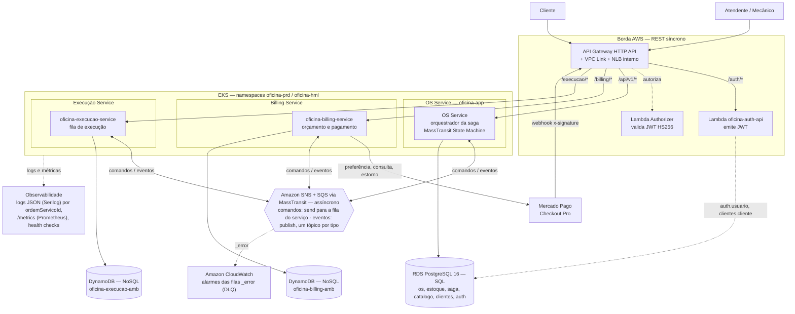
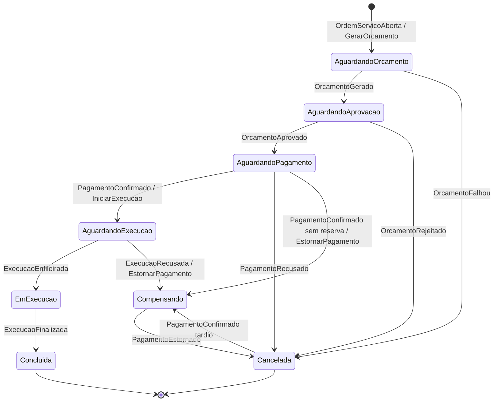

# Tech Challenge — Fase 4 — Documento de Entrega

**Curso:** Pós-Tech FIAP — Arquitetura de Software (15SOAT)
**Tema:** Sistema Integrado de Atendimento e Execução de Serviços para Oficina Mecânica — microsserviços e Saga Pattern
**Data de entrega:** 17/11/2026

---

## Equipe

| Nome | Discord |
|---|---|
| Thiago Fernandes da Cruz | @thiago_64271 |

---

## Links

### Repositórios

| Repositório | Papel na Fase 4 | Banco |
|---|---|---|
| https://github.com/lcr-thiago-fernandes/oficina-app | **OS Service**: atendimento, clientes, veículos, catálogo, estoque, OS e orquestrador da saga | PostgreSQL 16 (RDS) |
| https://github.com/lcr-thiago-fernandes/oficina-billing-service | **Billing Service**: orçamento, aprovação, pagamento e estorno no Mercado Pago | DynamoDB |
| https://github.com/lcr-thiago-fernandes/oficina-execucao-service | **Execução Service**: fila de execução por unidade, diagnóstico, reparo e finalização | DynamoDB |
| https://github.com/lcr-thiago-fernandes/oficina-infra-k8s | Plataforma compartilhada: VPC, EKS, NLB, API Gateway, parâmetros SSM e alarmes das filas `_error` | — |
| https://github.com/lcr-thiago-fernandes/oficina-infra-db | RDS PostgreSQL do OS Service | — |
| https://github.com/lcr-thiago-fernandes/oficina-lambda-auth | Lambda de autenticação (CPF e usuário/senha) e Lambda Authorizer | — |

### Documentação

| Item | Link |
|---|---|
| Vídeo de apresentação (≤15 min) | https://1drv.ms/f/c/fa2e7c7114d0ee1e/IgAZg-pFOF5fTJ1mQ_0nRLAmAcSgougV4IOc_4BL0KM_KVw?e=9aEKXJ |
| README (escolha da saga e justificativa) | https://github.com/lcr-thiago-fernandes/oficina-app/blob/main/README.md |
| Design arquitetural da Fase 4 | https://github.com/lcr-thiago-fernandes/oficina-app/blob/main/docs/arquitetura/fase4-design-arquitetural.md |
| RFC-006 — Microsserviços e Saga orquestrada | https://github.com/lcr-thiago-fernandes/oficina-app/blob/main/docs/rfc/RFC-006-microsservicos-saga-orquestrada.md |
| ADRs (ADR-021 a ADR-026 documentam as decisões da Fase 4) | https://github.com/lcr-thiago-fernandes/oficina-app/tree/main/docs/arquitetura |
| Contratos de mensagens da saga | https://github.com/lcr-thiago-fernandes/oficina-app/tree/main/docs/contratos/mensagens |
| Coleção de APIs | Swagger em `/swagger` (OS), `/billing/swagger` e `/execucao/swagger` + cenários em [`http/`](https://github.com/lcr-thiago-fernandes/oficina-app/tree/main/http) |

---

## Desenho da arquitetura



**Comunicação.** REST síncrono só na borda: atendente, cliente, mecânico e o webhook do
Mercado Pago entram pelo API Gateway (o Lambda Authorizer valida o JWT e cada serviço revalida).
Entre os serviços, só mensageria assíncrona (Amazon SNS + SQS via MassTransit): nenhum serviço
chama outro por HTTP e nenhum acessa o banco de outro. A Lambda de autenticação continua lendo
`auth.usuario` e `clientes.cliente` do PostgreSQL do OS Service, pelo contrato da Fase 3.

**Bancos (um por serviço).** OS Service: PostgreSQL 16 no RDS (relacional, SQL). Billing e
Execução: uma tabela DynamoDB cada (não relacional, NoSQL).

**Filas e tópicos** (prefixo `hml` | `prd`): `{prefixo}-oficina-billing-comandos`,
`{prefixo}-oficina-execucao-comandos`, `{prefixo}-oficina-os-saga` (eventos para a saga) e um
tópico SNS por mensagem, `{prefixo}-oficina-saga-{Nome}`. Falhas definitivas vão para a fila
`<endpoint>_error`, monitorada por alarme no CloudWatch.

| Serviço | NodePort prd / hml | Rotas no API Gateway |
|---|---|---|
| OS Service | 30080 / 30081 | `ANY /api/v1/{proxy+}` (Authorizer) |
| Billing | 30082 / 30083 | `ANY /billing/api/v1/{proxy+}` (Authorizer), `POST /billing/webhooks/mercadopago` (assinatura do Mercado Pago) |
| Execução | 30084 / 30085 | `ANY /execucao/api/v1/{proxy+}` (Authorizer) |

---

## Saga Pattern — estratégia escolhida: orquestração

A saga da OS tem quatro participantes lógicos (OS, Billing, Mercado Pago via Billing e
Execução), três pontos de falha depois da abertura e uma compensação em cascata (execução
recusada → estorno no Mercado Pago → reposição do estoque → cancelamento da OS). Por isso
escolhemos a **orquestração**: o orquestrador fica no OS Service, na classe `OrdemServicoSaga`
(MassTransit State Machine), com estado e trilha no schema `saga` do PostgreSQL, correlacionados
por `CorrelationId = OrdemServicoId`. Billing e Execução não conhecem a saga: recebem comandos e
publicam eventos.

| Abordagem | Prós | Contras |
|---|---|---|
| Coreografia | Sem ponto central; acoplamento fraco | Fluxo espalhado em três repositórios; dependência cíclica entre os serviços; difícil de testar ponta a ponta |
| **Orquestração (MassTransit State Machine no OS Service)** | Fluxo e compensações em um só lugar; dependências em mão única; testável com o test harness e BDD | Orquestrador é peça crítica (estado persistido no PostgreSQL + outbox, réplicas no K8s) |
| AWS Step Functions | Gerenciado, visual | Lógica fora do código .NET, difícil de cobrir com testes no CI |

Registro da decisão: README do `oficina-app`, RFC-006 e ADR-021.

### Máquina de estados da `OrdemServicoSaga`



Caminho feliz: o atendente abre a OS (`Recebida`, estoque reservado) → `GerarOrcamento` →
`OrcamentoGerado` → o cliente aprova no Billing (preferência criada no Mercado Pago) →
`OrcamentoAprovado` → confirmação do pagamento → `PagamentoConfirmado` → a OS baixa o estoque
reservado → `IniciarExecucao` → `ExecucaoEnfileirada` → o mecânico registra diagnóstico, reparo
e finalização → `ExecucaoFinalizada` → OS `Finalizada` (saga `Concluida`) → entrega do veículo.

### Passos e compensações

| # | Passo | Serviço | Falha | Compensação |
|---|---|---|---|---|
| 1 | Abrir OS + reservar estoque das peças | OS | saldo insuficiente | 422 síncrono; a saga não começa |
| 2 | Gerar orçamento | Billing | `OrcamentoFalhou` | OS libera a reserva; OS `Cancelada` |
| 3 | Aprovação do orçamento pelo cliente | Billing | `OrcamentoRejeitado` | Orçamento `Rejeitado`; OS libera a reserva; OS `Cancelada` |
| 4 | Cobrança no Mercado Pago | Billing | `PagamentoRecusado` | Billing cancela o orçamento; OS libera a reserva; OS `Cancelada` |
| 5 | Baixar o estoque reservado | OS | reserva já desfeita | `EstornarPagamento` → `PagamentoEstornado` → OS `Cancelada` |
| 6 | Enfileirar execução (pivô) | Execução | `ExecucaoRecusada` (capacidade esgotada) | Billing estorna no Mercado Pago; OS repõe o estoque; OS `Cancelada` |
| 7 | Diagnóstico, reparo e finalização | Execução → OS | — (após o pivô os passos são repetíveis) | — |
| — | Cancelamento pelo atendente antes do pagamento | OS | — | `CancelarOrcamento` ao Billing; OS libera a reserva |
| — | Pagamento confirmado depois do cancelamento | OS | — | `EstornarPagamento` |

Se o próprio estorno falhar (`EstornoFalhou`), a saga permanece em `Compensando` e registra
`CompensacaoFalhou` na trilha, para tratamento manual.

### Garantias

- **Reserva de estoque como *semantic lock*** (ADR-025): o estoque só é baixado depois do
  pagamento, e outra OS nunca lê um saldo que ainda pode voltar.
- **Transactional Outbox no OS Service** (ADR-024): mensagem, estado da saga e alterações do
  domínio na mesma transação PostgreSQL; o inbox do MassTransit deduplica mensagens.
- **Idempotência nos participantes**: Billing e Execução gravam no DynamoDB com escrita
  condicional antes de publicar; o webhook do Mercado Pago é deduplicado por `payment_id`.
- **Versão otimista**: `xmin` no PostgreSQL e atributo `versao` no DynamoDB.
- **Retry**: três tentativas exponenciais dentro de redelivery atrasado; falha definitiva vai para
  a fila `_error`.
- **Contratos**: cada repositório declara as próprias classes de mensagem com o mesmo URN
  (`oficina:saga:<Nome>`), validadas por testes de contrato contra os JSONs versionados.

---

## Justificativa da divisão dos microsserviços e das tecnologias

| Decisão | Justificativa | Registro |
|---|---|---|
| **Três serviços: OS, Billing e Execução** | Correspondem às três áreas do desafio (atendimento, cobrança e oficina), com ciclos e dados próprios; o Billing isola a integração com o Mercado Pago. Clientes, veículos, catálogo e estoque ficam no OS Service por serem o contexto de atendimento e a origem dos preços do orçamento | RFC-006 |
| **Saga orquestrada no OS Service** | Fluxo e compensações num lugar só, testável no CI | ADR-021 |
| **Assíncrono entre serviços, REST só na borda** | Um serviço fora do ar não trava os outros: a mensagem espera na fila e a saga retoma | RFC-006 |
| **Amazon SNS + SQS via MassTransit 8.x** | Serviço gerenciado, custo baixo e LocalStack no ambiente local; o MassTransit 8.x (Apache-2.0) traz saga, outbox, retry e test harness | ADR-022 |
| **PostgreSQL 16 no OS Service (SQL)** | Domínio relacional (cliente, veículo, OS, itens, peças), reserva de estoque transacional e estado da saga na mesma transação do domínio | ADR-023 |
| **DynamoDB no Billing e na Execução (NoSQL)** | Orçamento, pagamento e fila de execução são documentos por OS lidos por chave; escrita condicional dá idempotência e lock otimista | ADR-023 |
| **Mercado Pago Checkout Pro** | Preferência com `external_reference = osId`, confirmação por `GET /v1/payments/{id}`, estorno por `POST /v1/payments/{id}/refunds` e webhook validado por `x-signature` (HMAC-SHA256). A entrega e o vídeo usam o modo simulador do Billing (`Pagamento__Modo=Simulado`) | design §6.2 |
| **SonarQube no CI** | Análise com quality gate em todo PR | ADR-026 |

Mantidos da Fase 3: AWS (EKS, RDS, API Gateway + Lambda Authorizer), C# / .NET 8 com Clean
Architecture em todos os serviços, Terraform e GitHub Actions com OIDC. Cada serviço tem a mesma
estrutura do `oficina-app` (código, testes, `Dockerfile`, `k8s/`, `terraform/`, pipelines,
`docs/` e `http/`) e infraestrutura própria (ECR, tabela DynamoDB, role IRSA, target group no NLB
e rotas no API Gateway), lendo do SSM os parâmetros publicados pelo `oficina-infra-k8s`.

| Camada | Tecnologia |
|---|---|
| Linguagem / Web | C# 12 / .NET 8, ASP.NET Core |
| Persistência | EF Core 8 + Npgsql (OS); AWS SDK DynamoDB (Billing, Execução) |
| Mensageria / saga | MassTransit 8.x sobre Amazon SNS + SQS; LocalStack no ambiente local |
| Pagamento | Mercado Pago Checkout Pro + simulador |
| Testes | xUnit, FluentAssertions, Moq, Coverlet, Testcontainers, MassTransit test harness, Reqnroll (BDD) |
| Qualidade | SonarQube, CodeQL, Dependabot |
| Plataforma | Docker, Kubernetes (AWS EKS, HPA, IRSA), API Gateway HTTP API, Terraform, GitHub Actions com OIDC |
| Observabilidade | Serilog (JSON), Prometheus `/metrics`, health checks, CloudWatch |

---

## Qualidade e CI/CD

| Serviço | Testes | Cobertura de linha | SonarQube |
|---|---|---|---|
| OS Service | 732 | 93,6% | Quality Gate `OK` |
| Billing Service | 308 | 96,9% | Quality Gate `OK` |
| Execução Service | 165 | 96,6% | Quality Gate `OK` |

- O CI de cada serviço quebra se a cobertura de linha cair abaixo de 80%; as evidências ficam no
  README e em `docs/evidencias/` de cada repositório.
- **BDD (Reqnroll, Gherkin em português)**: fluxo completo da OS no OS Service (caminho feliz,
  orçamento rejeitado, pagamento recusado e execução recusada com estorno), fluxo de pagamento no
  Billing e fluxo da fila na Execução.
- **CI** (`ci.yml`): build, testes com gate de 80%, `sonar`, `codeql` e build da imagem.
  **CD** (`cd.yml`): build → push no ECR → `kubectl apply` + `rollout status`; `develop` →
  `oficina-hml`, `main` → `oficina-prd`. Infraestrutura própria de cada serviço por `infra.yml`
  (Terraform). Todos os pipelines usam OIDC, sem chaves AWS estáticas.
- Proteção da branch `main` (PR obrigatório e checks automáticos) configurada por
  `scripts/setup-branch-protection.sh` em cada repositório.

---

## Observabilidade

- **Logs estruturados** (Serilog JSON) nos três serviços, correlacionados por `ordemServicoId`
  e pelo cabeçalho `X-Correlation-Id`, propagado também nas mensagens da saga.
- **Métricas Prometheus** em `/metrics` e **health checks** em cada serviço.
- **Trilha da saga**: `GET /api/v1/ordens-servico/{id}/saga` retorna o estado e cada passo
  executado, com resultado, compensação e duração.
- **Alarmes no CloudWatch** sobre as filas `_error` (DLQ) da saga
  (`oficina-infra-k8s/terraform/alarmes-dlq.tf`), com notificação por e-mail via SNS.
- Os serviços mantêm a instrumentação de APM da Fase 3, ligada por configuração no
  Deployment.

---

## Como executar (resumo)

**Local (os três serviços):** com `oficina-app`, `oficina-billing-service` e
`oficina-execucao-service` clonados lado a lado:

```bash
cd oficina-app
cp .env.example .env    # ADMIN_BOOTSTRAP_PASSWORD, JWT_SECRET
docker compose -f docker/docker-compose.fase4.yml --env-file .env up -d --build --wait
# OS :8080 · Billing :8082/billing · Execução :8083/execucao
```

O arquivo [`http/fase4-demo.http`](https://github.com/lcr-thiago-fernandes/oficina-app/blob/main/http/fase4-demo.http)
percorre o caminho feliz até a entrega e os fluxos de falha (orçamento rejeitado, pagamento
recusado e execução recusada com estorno).

**AWS:** `oficina-infra-k8s` → `oficina-infra-db` → `oficina-lambda-auth` → `oficina-app` →
`oficina-billing-service` → `oficina-execucao-service`. Cada serviço aplica a própria
infraestrutura pelo `infra.yml` e é implantado pelo CD no EKS (`oficina-hml` e `oficina-prd`).
Passo a passo no README de cada repositório.
